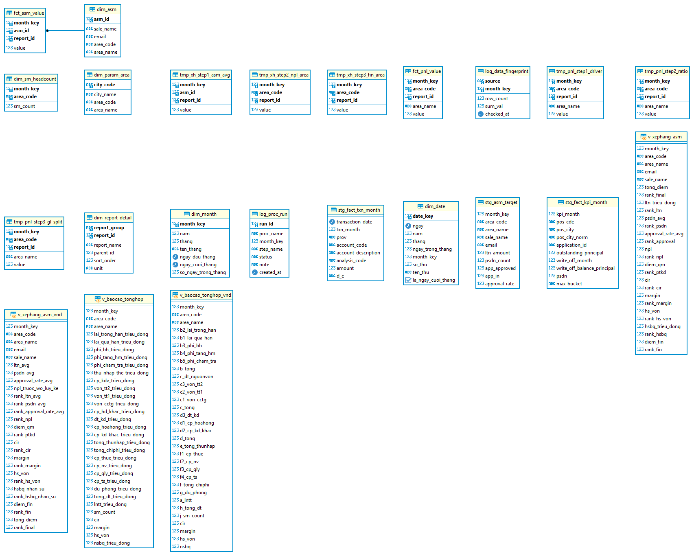

<div align="center">

# Phân Tích Lãi Lỗ Và Hiệu Suất Kinh Doanh Thẻ Tín Dụng

### Chuyên viên Phân tích Dữ liệu · Công cụ chính: SQL trên PostgreSQL

<p>
  
  
  
  
</p>

<p>
  Dự án phân tích dữ liệu từ đầu đến cuối: từ 3 tệp Excel thô (<strong>2.996.476 dòng</strong>) đến
  báo cáo lãi lỗ 7 vùng, bảng xếp hạng giám đốc vùng, và một câu chuyện chẩn đoán trả lời câu hỏi:
  <em>“Lợi nhuận tăng ở đâu, vì cái gì, và có bền không?”</em>
</p>

</div>

## 📑 Mục Lục

1. [📌 Tổng Quan Dự Án](#-tổng-quan-dự-án)
2. [🔄 Quy Trình Xử Lý Kỹ Thuật: 4 Giai Đoạn](#-quy-trình-xử-lý-kỹ-thuật-4-giai-đoạn)
3. [🗄️ Kho Dữ Liệu: 18 Bảng Và 4 View](#-kho-dữ-liệu-18-bảng-và-4-view)
4. [🧮 Tầng Tính Toán Trong SQL](#-tầng-tính-toán-trong-sql)
5. [📊 Phân Tích: Lợi Nhuận Và Rủi Ro Tập Trung Ở Đâu](#-phân-tích-lợi-nhuận-và-rủi-ro-tập-trung-ở-đâu)
6. [🔍 Chẩn Đoán: Phân Rã, Ma Trận, Xếp Hạng](#-chẩn-đoán-phân-rã-ma-trận-xếp-hạng)
7. [🧪 Kiểm Chứng Số Liệu](#-kiểm-chứng-số-liệu)
8. [🖥️ Hệ Thống Hỗ Trợ Ra Quyết Định](#-hệ-thống-hỗ-trợ-ra-quyết-định)
9. [📂 Cấu Trúc Dự Án](#-cấu-trúc-dự-án)
10. [📚 Bài Học Rút Ra](#-bài-học-rút-ra)
11. [📖 Tài Liệu](#-tài-liệu)
12. [💼 Kỹ Năng Thể Hiện](#-kỹ-năng-thể-hiện)

---

## 📌 Tổng Quan Dự Án

### 🏢 Bối Cảnh Nghiệp Vụ

Khối thẻ tín dụng có **7 vùng kinh doanh** và **74 đến 84 giám đốc vùng** tuỳ tháng, với một vấn đề quen thuộc: **doanh thu và chi phí không phát sinh tại nơi được báo cáo**. Chi phí công nghệ, chi phí tiếp thị toàn hàng và vốn điều chuyển đều nằm ở Hội sở. Nếu không phân bổ đúng, “lãi lỗ theo vùng” chỉ là con số trang trí, và mọi kết luận về hiệu quả kinh doanh đều sai từ gốc.

Dự án nhận dữ liệu thô gồm **sổ cái kế toán, sao kê giao dịch và chỉ tiêu kinh doanh của giám đốc vùng**, dựng lại toàn bộ tầng tính toán trong PostgreSQL, xuất báo cáo Excel đúng mẫu kế toán quản trị, và dựng bảng điều khiển chẩn đoán trên Power BI.

### 🎯 Câu Hỏi Kinh Doanh

| Câu hỏi | Cách trả lời trong dự án |
|---|---|
| Vùng nào thực sự lãi, vùng nào thực sự lỗ? | Phân bổ chi phí Hội sở theo 2 quy tắc, kiểm bất biến tổng |
| Mức tăng lợi nhuận đến từ kinh doanh hay từ dự phòng giảm? | Phân rã biến động thành 6 cấu phần cho từng vùng |
| Giám đốc vùng nào đang làm tốt mà không đẩy rủi ro? | Xếp hạng 8 chỉ số chia 2 trụ cột độc lập |
| Số trên báo cáo có đáng tin không? | 4 lớp kiểm soát, đối soát hai nguồn độc lập |

### 💡 Kết Quả Dự Án

- **Phát hiện** — Lợi nhuận tháng 5 tăng **+4.390,9 triệu đồng** so với tháng 4 (tương đương +8,4%), trong đó **97,2%** đến từ một vùng duy nhất (Tây Nam Bộ) và phần lớn nhờ **dự phòng giảm**, không phải thu nhập tăng.
- **Cảnh báo** — **1 trong 7 vùng lỗ** (Đông Nam Bộ, −8.787,4 triệu đồng); **3 trong 7 vùng giảm** lợi nhuận; vùng lãi nhất lại có nợ xấu cao nhất (**21,99%**) và **0 trong 16** giám đốc vào nhóm 25 vị trí đầu.
- **Kiểm chứng** — **91 phép đối soát giữa Power BI và PostgreSQL: 0 sai lệch**; đối chiếu mẫu báo cáo gốc theo từng ô, khớp cả ba số tổng và toàn bộ ô đối chiếu được.
- **Bàn giao** — Tệp Excel giữ nguyên mẫu ngân hàng (công thức, định dạng, trang tham số), kèm bộ tài liệu vận hành và **41 mục lỗi thực chiến** đã ghi cách xử lý.

Báo cáo phục vụ **rà soát và ra quyết định điều hành**; không thay thế quy trình kế toán chính thức và không dùng để tự động đánh giá hay thưởng cá nhân.

---

## 🛠️ Công Cụ Và Công Nghệ

| Tầng | Công cụ | Vai trò |
|---|---|---|
| Nạp dữ liệu | Python 3.10, pandas, openpyxl, psycopg2 | Đọc 3 tệp Excel thô, xoay bảng, chuẩn hoá tên tỉnh, chặn nạp trùng |
| Kho dữ liệu | PostgreSQL, PL/pgSQL | 18 bảng, 4 view, 2 thủ tục lưu sẵn |
| Kiểm tra | DBeaver | Soi số từng bước, đối chiếu bất biến |
| Trực quan | Power BI Desktop, Import, DAX | 5 trang báo cáo, 72 measures |
| Đối chiếu | ADOMD, Excel | 91 phép đối soát tự động, 0 lệch |

Logo ứng dụng của từng tầng, cùng bộ huy hiệu ở đầu trang:

<p>
  
  
  
  
  
</p>

---

## 🔄 Quy Trình Xử Lý Kỹ Thuật: 4 Giai Đoạn

Từ cơ sở dữ liệu thô đến hệ thống báo cáo hoàn chỉnh — mỗi giai đoạn một công cụ, một đầu ra kiểm chứng được. Toàn bộ kho sau ba giai đoạn đầu: **18 bảng** (8 bảng nghiệp vụ, 4 bảng nạp, 6 bảng tạm) và **4 view**.


| # | Giai đoạn | Công cụ | Đầu ra | Quy mô |
|---|---|---|---|---|
| 1 | Dữ liệu đầu vào | Excel | 3 tệp số liệu và 1 tệp tham số | 2,99 triệu dòng |
| 2 | Nạp và làm sạch | Python | 2 bảng danh mục, 4 bảng nạp | **6 bảng** |
| 3 | Kho và tính toán | PostgreSQL, DBeaver | 3 bảng danh mục, 2 bảng kết quả, 1 bảng nhật ký, 6 bảng tạm, 4 view | **12 bảng** |
| 4 | Vẽ báo cáo | Power BI | 5 trang, Import 2 view | — |

**Giai đoạn 1 — Dữ liệu đầu vào (Excel).** Ba tệp số liệu: sổ hợp đồng **2.932.914 dòng**, sổ bút toán **63.134 dòng**, chỉ tiêu **84 giám đốc vùng** tháng 5 — kèm tệp tham số `report_xep_hang_kinh_doanh_monthly.xlsx` (64 tỉnh về 8 vùng, mô tả tài khoản thuộc dòng lãi lỗ nào, và là mẫu đối chiếu 2 báo cáo đầu ra).

**Giai đoạn 2 — Nạp và làm sạch (Python) ra 6 bảng.** Bóc dữ liệu từng trang, **xoay bảng** (84 dòng giám đốc vùng nằm ngang chuyển thành dọc), **chuẩn hoá tên tỉnh** (`pos_city_norm`, ví dụ “Bà Rịa - Vũng Tàu” thuộc vùng H), chặn nạp trùng bằng dấu vân tay tệp. Tạo 2 bảng danh mục (`dim_param_area` 64 dòng, `dim_asm` 84 dòng) và 4 bảng nạp (`stg_asm_target` 420, `stg_fact_txn_month` 63.134, `stg_fact_kpi_month` 2.932.922, `stg_fingerprint` 15).

**Giai đoạn 3 — Kho và tính toán (PostgreSQL, DBeaver) ra 12 bảng và 4 view.** Thủ tục `sp_baocao_tonghop` chia tiền Hội sở về 7 vùng theo 2 quy tắc; thủ tục `sp_xephang_asm` chấm điểm từng giám đốc vùng. Tạo 3 bảng danh mục (`dim_month` 5, `dim_report_detail` 50 chỉ tiêu, `dim_sm_headcount` 35), 2 bảng kết quả (`fct_pnl_value` 1.115, `fct_asm_value` 8.536), 1 bảng nhật ký (`log_proc_run` 65), 6 bảng tạm (3 bước tính lãi lỗ và 3 bước tính xếp hạng) và 4 view: 2 view báo cáo (`v_baocao_tonghop`, `v_xephang_asm`) cùng 2 bản đơn vị đồng (`v_baocao_tonghop_vnd`, `v_xephang_asm_vnd`) để xuất Excel.

**Giai đoạn 4 — Vẽ báo cáo (Power BI).** Kết nối **Import** vào 2 view, lọc theo `dim_month`, dựng 5 trang: Tổng quan, Từ điển dữ liệu, Kết quả kinh doanh, Xếp hạng quản lý vùng, Phân tích chuyên sâu. Số liệu được nạp vào bộ nhớ của mô hình, nên đổi tháng trên slicer là số đổi theo ngay; khi cơ sở dữ liệu có tháng mới thì chạy Refresh để kéo thêm bản ghi.

---

## 🗄️ Kho Dữ Liệu: 18 Bảng Và 4 View

Toàn bộ kho nằm trong một lược đồ duy nhất `banking_project`. Quy ước đặt tên: `dim_` cho bảng danh mục, `stg_` cho bảng nạp thô, `fct_` cho bảng kết quả, `tmp_` cho bảng tạm phục vụ kiểm tra từng bước, `v_` cho view.

| Nhóm | Số bảng | Bảng và số dòng | Vai trò |
|---|---:|---|---|
| Danh mục | 5 | `dim_param_area` 64 · `dim_asm` 84 · `dim_month` 5 · `dim_report_detail` 50 · `dim_sm_headcount` 35 | Định nghĩa vùng, giám đốc vùng, tháng, chỉ tiêu, nhân sự |
| Nạp thô | 4 | `stg_fact_kpi_month` 2.932.922 · `stg_fact_txn_month` 63.134 · `stg_asm_target` 420 · `stg_fingerprint` 15 | Giữ nguyên dữ liệu gốc để đối chiếu lại |
| Kết quả | 2 | `fct_pnl_value` 1.115 · `fct_asm_value` 8.536 | Số đã phân bổ và điểm xếp hạng |
| Nhật ký | 1 | `log_proc_run` 65 | Ghi lại mỗi lần chạy thủ tục, từng bước, trạng thái |
| Tạm | 6 | 3 bảng `tmp_pnl_step1_driver`, `tmp_pnl_step2_ratio`, `tmp_pnl_step3_gl_split` · 3 bảng `tmp_xh_step1_asm_avg`, `tmp_xh_step2_npl_area`, `tmp_xh_step3_fin_area` | Mỗi bước tính để một bảng riêng, kiểm được ngay trong DBeaver; tên bảng gắn luôn số bước; cả 6 cùng khuôn dọc (khoá + `report_id` + một cột `value`), không có bảng ngang nào |

**Độ chi tiết của bảng kết quả** — thông tin quan trọng nhất khi đọc một bảng:

| Bảng | Một dòng nghĩa là gì | Kiểm chứng |
|---|---|---|
| `fct_pnl_value` | 1 tháng × 1 vùng × 1 chỉ tiêu | 28 chỉ tiêu × 7 vùng = 196 dòng, cộng 27 dòng quỹ Hội sở = 223 dòng mỗi tháng, đủ 5 tháng là 1.115 |
| `fct_asm_value` | 1 tháng × 1 giám đốc vùng × 1 chỉ tiêu | 22 chỉ tiêu; tháng 1 có 74 người nên 74 × 22 = 1.628 dòng, tháng 5 có 84 người nên 84 × 22 = 1.848 dòng |
| `dim_report_detail` | 1 chỉ tiêu trong cây cha con | 28 chỉ tiêu lãi lỗ và 22 chỉ tiêu xếp hạng, gốc `parent_id = -1` |

**4 view**, tất cả đều phục vụ trình bày — 2 view báo cáo `v_baocao_tonghop` (35 dòng = 7 vùng × 5 tháng) và `v_xephang_asm` (388 dòng), cùng 2 bản đơn vị đồng `v_baocao_tonghop_vnd` (35 dòng) và `v_xephang_asm_vnd` (388 dòng) dùng cho xuất Excel. View báo cáo loại sẵn vùng `'00'` (quỹ Hội sở) để không cộng trùng.

**Hướng thiết kế.** Lược đồ đi theo mô hình sao, dựng thành 5 lớp và giữ bảng sự kiện ở dạng cao:

| Lớp | Số bảng | Vai trò |
| :--- | :---: | :--- |
| Nạp thô `stg_` | 4 | Chép nguyên từ tệp Excel, không sửa gì, để còn dò lại nguồn |
| Danh mục `dim_` | 5 | Dùng chung cho cả hai báo cáo: tháng, vùng, chỉ tiêu, giám đốc, nhân sự |
| Bảng tạm `tmp_` | 6 | Mỗi bước tính một bảng, xoá và dựng lại theo từng tháng |
| Kết quả `fct_` | 2 | Một dòng là một tháng × một đối tượng × một chỉ tiêu |
| Trình bày `v_` | 4 | Xoay dọc thành ngang, đổi sang đồng, loại quỹ Hội sở |

- **Bảng sự kiện dạng cao** gồm `month_key`, đối tượng, `report_id` và một cột `value`. Thêm chỉ tiêu mới chỉ là thêm một dòng vào danh mục chỉ tiêu, không phải sửa cấu trúc bảng; đổi lại view phải xoay dọc thành ngang trước khi đưa lên báo cáo.
- **Danh mục chỉ tiêu dùng chung**: `dim_report_detail` giữ cả 28 chỉ tiêu lãi lỗ và 22 chỉ tiêu xếp hạng, xếp cây cha con qua `parent_id`, nên hai báo cáo nói cùng một ngôn ngữ chỉ tiêu.
- **Hai bảng sự kiện tách riêng** vì khác độ chi tiết (vùng và giám đốc) và khác thứ tự chạy: phần xếp hạng đọc lại kết quả lãi lỗ nên bắt buộc chạy sau.
- **Khoá tự nhiên là chính**: `month_key` dạng 202305, `area_code`, `city_code`; riêng `dim_asm` dùng khoá thay thế và giữ `email` làm khoá duy nhất.
- **Chỉ một khoá ngoại khai báo thật** vì bảng nạp có thể chứa thành phố chưa ghép được vùng, chặn lúc nạp sẽ làm gãy cả tháng dữ liệu; chỗ nối còn lại kiểm bằng truy vấn (0 dòng mồ côi) thay vì ràng buộc. Bảng sự kiện lãi lỗ giữ thêm `area_name` để view không phải nối lại.
- **Đẩy logic xuống SQL**: view đã xoay, đã đổi đơn vị, đã loại quỹ Hội sở, nên Power BI chỉ việc kéo thả; muốn đổi cách tính thì sửa một chỗ.

**Cách hình thành.** Đi ngược từ hai báo cáo mẫu ra, theo bốn bước thiết kế của Kimball rồi ba quyết định kỹ thuật. Cột phải là thứ có thật trong lược đồ:

| Bước | Việc đã làm | Kết quả trong lược đồ |
| :---: | :--- | :--- |
| 1 | Chọn quy trình: lãi lỗ theo vùng và xếp hạng giám đốc vùng, khác độ chi tiết nên tách hai bảng | `fct_pnl_value`, `fct_asm_value` |
| 2 | Khai độ chi tiết trước khi chọn cột | Khoá chính `(month_key, area_code, report_id)` và `(month_key, asm_id, report_id)` |
| 3 | Gom chiều dùng chung cho cả hai báo cáo | `dim_month` 5, `dim_param_area` 64, `dim_asm` 84, `dim_report_detail` 50, `dim_sm_headcount` 35 |
| 4 | Mỗi dòng một số đo, để dọc thay vì 28 đến 22 cột | Một cột `value`; thêm chỉ tiêu chỉ là thêm dòng vào `dim_report_detail` |
| 5 | Giữ lớp nạp thô và lớp từng bước để kiểm giữa chừng | 4 bảng `stg_`, 6 bảng `tmp_` (3 bước lãi lỗ, 3 bước xếp hạng) — cả 6 cùng khuôn dọc, không có bảng ngang nào |
| 6 | Phần trình bày làm trong view, không làm trong Power BI | 4 view xoay dọc thành ngang, chia 1 triệu, loại quỹ `'00'` |

**Tên gọi.** **Star schema theo phương pháp Kimball**, biến thể **bảng sự kiện dạng cao** (tall fact), đọc bằng **pivot-on-read**. Không phải chuẩn hoá 3NF, không phải snowflake đầy đủ, không phải Data Vault.

**Bốn chỗ lệch chuẩn Kimball.** Phần lõi đúng: độ chi tiết khai rõ, danh mục dùng chung, dạng sao, thuộc tính để phẳng.

| Chỗ lệch | Chuẩn Kimball | Thực tế trong lược đồ |
| :--- | :--- | :--- |
| Khoá danh mục | Khoá thay thế cho mọi danh mục | Chỉ `dim_asm` có; còn lại `month_key`, `area_code`, `city_code` là khoá tự nhiên |
| Ràng buộc tham chiếu | Khai khoá ngoại để chặn dữ liệu lạc | Chỉ 1 khoá ngoại thật (`fct_asm_value` → `dim_asm`), còn lại kiểm bằng truy vấn |
| Thuộc tính trong bảng sự kiện | Chỉ khoá và số đo | `fct_pnl_value` mang thêm `area_name` để view khỏi nối |
| Khoá nối danh mục chỉ tiêu | Bảng sự kiện giữ đủ khoá danh mục | Danh mục khoá ghép `(report_group, report_id)`, bảng sự kiện chỉ lưu `report_id`; an toàn vì hai dải mã đi vào bảng sự kiện là 1–94 và 201–222 không trùng. Dải **231–232** tồn tại ở bảng tạm bước nợ xấu (tử số, mẫu số) chỉ để đối chiếu và không bao giờ ghi sang bảng sự kiện |

### Sơ đồ quan hệ giữa các bảng

Sơ đồ dưới đây đọc trực tiếp từ lược đồ `banking_project` trong PostgreSQL: 22 đối tượng (18 bảng và 4 view), khoá chính, khoá ngoại và luồng dữ liệu giữa các bước. Mỗi cột ghi tên cột và kiểu dữ liệu, viền trên là nhóm bảng theo giai đoạn.



Cách đọc: mũi tên liền là luồng dữ liệu chạy trong thủ tục (bảng tạm của bước trước thành đầu vào của bước sau), mũi tên đứt là liên kết tra cứu theo khoá. Chỉ có **một khoá ngoại khai báo thật** trong lược đồ là `fct_asm_value.asm_id` trỏ về `dim_asm.asm_id`; các liên kết còn lại là join theo `month_key`, `area_code`, `report_id` và được viết rõ trong từng view. Bảng `log_proc_run` và `stg_fingerprint` đứng riêng vì chỉ phục vụ giám sát, không tham gia tính toán.

---

## 🧮 Tầng Tính Toán Trong SQL

Đây là phần chiếm nhiều công sức nhất của dự án: chuyển quy tắc kế toán quản trị thành thủ tục lưu sẵn, chạy lại được từng tháng, và tự kiểm tra ngay trong câu lệnh.

### Hai quy tắc phân bổ

| Quy tắc | Nội dung | Cách kiểm |
|---|---|---|
| **Quy tắc 1 — Gán thẳng** | Khoản phát sinh tại đơn vị nào tính 100% cho vùng đó (theo mã đơn vị trên sổ cái) | Đối chiếu tổng theo mã đơn vị với sổ cái gốc |
| **Quy tắc 2 — Phân bổ** | Phần Hội sở chia theo tỉ lệ của tiêu thức nghiệp vụ thật: dư nợ nhóm 1, dư nợ nhóm 2 đến 5, doanh số phát sinh, số lượng nhân sự, tổng dư nợ | Tổng tỉ lệ 7 vùng bằng 1,000000 (sai số không quá 1e-6) |

### Năm bước trong thủ tục `sp_baocao_tonghop`

```text
Bước 1  Đọc đủ 9 tiêu thức phân bổ, tính theo vùng        → tmp_pnl_step1_driver    315 dòng
Bước 2  Tính tỉ lệ phân bổ, kiểm tổng bằng 1              → tmp_pnl_step2_ratio     560 dòng
Bước 3  Tách phần gán thẳng và phần Hội sở trên sổ cái    → tmp_pnl_step3_gl_split  535 dòng
Bước 4  Cộng hai phần, ghi kết quả cuối                   → fct_pnl_value         1.115 dòng
Bước 5  Tính các chỉ số tổng hợp (E, F, H, A và 4 tỉ số)  → fct_pnl_value
```

Mỗi bước để lại một bảng tạm riêng, nên khi một con số sai thì biết sai ở bước nào thay vì mở một câu lệnh dài hàng trăm dòng. Ba bước đầu chỉ tính trung gian, từ bước 4 mới ghi vào bảng kết quả; tên bảng mang luôn số bước (`tmp_pnl_step{N}_...`) nên tra trong DBeaver là khớp với tên bước trong nhật ký. Thủ tục ghi nhật ký `START` và 5 dòng `OK` cho mỗi tháng chạy.

### Xếp hạng giám đốc vùng

Phần này làm theo đúng cách của phần lãi lỗ: mỗi bước ghi ra một bảng tạm kiểm được trong DBeaver, rồi mới gộp thành kết quả.

**Tám chỉ số, hai trụ cột**

| Trụ cột | Chỉ số | Chiều tốt | Nguồn |
| :--- | :--- | :---: | :--- |
| Kinh doanh (`diem_qm`) | Lợi nhuận trước thuế lũy kế bình quân, doanh số phát sinh lũy kế bình quân, tỉ lệ duyệt hồ sơ bình quân | Cao là tốt | Bảng nạp giám đốc vùng; bình quân các tháng đã có, bỏ qua ô trống |
| Kinh doanh (`diem_qm`) | Nợ xấu của vùng | Thấp là tốt | Dư nợ nhóm 3 đến 5 trên tổng dư nợ, giữ cả tử số và mẫu số (hai dòng riêng trong bảng tạm bước 2) để kiểm lại |
| Tài chính (`diem_fin`) | Tỉ lệ chi phí trên thu nhập, biên lợi nhuận, hiệu suất vốn, hiệu suất vốn bình quân | Tỉ lệ chi phí thấp là tốt, ba chỉ số còn lại cao là tốt | Đọc lại từ kết quả lãi lỗ của vùng, không tính lại |

**Sáu bước trong thủ tục `sp_xephang_asm`**

```text
Bước 1  Bình quân lũy kế 3 chỉ số của từng giám đốc                    → tmp_xh_step1_asm_avg    1.164 dòng
Bước 2  Nợ xấu từng vùng, giữ tử số và mẫu số                          → tmp_xh_step2_npl_area     105 dòng
Bước 3  4 chỉ số tài chính và hạng của 7 vùng                           → tmp_xh_step3_fin_area     315 dòng
Bước 4  Xếp hạng 4 chỉ số, cộng điểm kinh doanh, hạng hiệu quả kinh doanh → fct_asm_value      10 dòng/người
Bước 5  Nhân điểm tài chính của vùng cho giám đốc thuộc vùng            → fct_asm_value       9 dòng/người
Bước 6  Cộng hai trụ cột, xếp hạng tổng kết                             → fct_asm_value       3 dòng/người
```

Điểm của mỗi trụ cột là **tổng hạng** chứ không phải điểm thô, nên các chỉ số khác đơn vị đo vẫn cộng được mà không phải quy đổi: hạng 1 là tốt nhất, tổng hạng càng nhỏ càng tốt. Phần tài chính tính theo vùng, nên mọi giám đốc cùng vùng nhận cùng điểm tài chính; chỉ trụ cột kinh doanh mới phân biệt người với người. Yêu cầu nghiệp vụ “không thưởng cho việc đẩy nợ xấu để chạy doanh số” nhờ vậy nằm ngay trong công thức: nợ xấu là một chỉ số riêng, chiều thấp là tốt, không phải lời khuyên bên lề.

**Đồng điểm thì xử lý thế nào.** Dữ liệu thật có đồng điểm: 46 nhóm trong 5 tháng, có tháng 3 người cùng điểm. Hàm `RANK()` cho người đồng điểm **cùng một hạng** và hạng kế tiếp bị nhảy, nên tháng 1 có 74 người nhưng chỉ 67 hạng khác nhau. Con số hạng vì vậy vẫn tất định; chỗ chưa tất định là thứ tự hiển thị bên trong nhóm đồng hạng. Khi trình bày cần thêm khoá phá hoà, ví dụ `ROW_NUMBER() OVER (ORDER BY tong_diem, email)`, để hai lần chạy cho cùng một thứ tự.

---

## 📊 Phân Tích: Lợi Nhuận Và Rủi Ro Tập Trung Ở Đâu

| Vùng kinh doanh | Giám đốc vùng tháng 5 | Số tháng dữ liệu | Dòng thô | Lợi nhuận trước thuế tháng 5 | Biến động so với tháng 4 |
| :---: | :---: | :---: | :---: | :---: | :---: |
| **7** | **84** | **5** (tháng 1 đến tháng 5 năm 2023) | **2.996.476** | **250.450,06 triệu đồng** | **+4.390,9 triệu đồng** |

### Bốn nhận xét chính

**01. Tăng trưởng không đến từ kinh doanh.**
Tây Nam Bộ tăng **+4.267,8 triệu đồng**, nhưng thu nhập thuần chỉ **+16,3 triệu đồng**, gần như đi ngang. Toàn bộ mức tăng đến từ **dự phòng giảm +4.447,3 triệu đồng**, trong khi chi phí hoạt động tăng thêm **−195,9 triệu đồng**. Vùng này đồng thời có **nợ xấu cao nhất hệ thống (21,99%)** và **0 trong 16** giám đốc vào nhóm 25 vị trí đầu. Quy mô: vùng chiếm **97,2%** mức tăng lợi nhuận toàn hệ thống trong tháng.

**02. Vùng lỗ duy nhất cũng là vùng có thứ hạng nhân sự thấp nhất.**
Đông Nam Bộ lỗ **−8.787,4 triệu đồng**, biến động **−322,2 triệu đồng**. Thu nhập thuần **+3.210,7 triệu đồng** (kinh doanh vẫn tốt lên) nhưng dự phòng **−3.234,2 triệu đồng** (rủi ro xấu đi). **16 trong 19** giám đốc nằm trong nhóm 24 vị trí cuối — đủ để ưu tiên điều tra, chưa đủ để kết luận nguyên nhân.

**03. Lợi nhuận và xếp hạng không nói cùng một câu chuyện.**
Nam Trung Bộ có lợi nhuận tháng thấp hơn nhiều vùng khác nhưng **4 trong 5** giám đốc vào nhóm 25 vị trí đầu và nợ xấu thấp nhất (**11,24%**). Đồng bằng Sông Hồng có **10 trong 23** giám đốc vào nhóm đầu, nhưng kết quả tài chính tháng này không phản ánh điều đó. Một báo cáo chỉ có một trong hai thước đo sẽ dẫn ban điều hành đến quyết định sai.

**04. Tăng trưởng ảo.**
Đồng bằng Sông Hồng tăng **+1.310,9 triệu đồng**, nhưng **thu nhập thuần âm −232,2 triệu đồng**. Toàn bộ mức tăng đến từ dự phòng **+1.455,8 triệu đồng**, cùng bản chất với Tây Nam Bộ nhưng ở quy mô nhỏ hơn.

---

## 🔍 Chẩn Đoán: Phân Rã, Ma Trận, Xếp Hạng

### Phân rã biến động

Dữ liệu nguồn là lũy kế từ đầu năm, nên mọi so sánh phải đi qua **lợi nhuận phát sinh trong tháng**:

```text
Lợi nhuận phát sinh tháng t = Lợi nhuận lũy kế (t) − Lợi nhuận lũy kế (t − 1)
Biến động so với tháng trước = Dòng chảy (t) − Dòng chảy (t − 1)
```

| Vùng | Tổng biến động | Thu nhập thuần | Dự phòng | Cách đọc |
| :--- | :---: | :---: | :---: | :--- |
| **Tây Nam Bộ** | **+4.267,8** | +16,3 | **+4.447,3** | Tăng nhờ dự phòng giảm, không nhờ kinh doanh |
| **Đông Nam Bộ** | **−322,2** | **+3.210,7** | **−3.234,2** | Kinh doanh tốt lên nhưng rủi ro xấu đi |
| **Đồng bằng Sông Hồng** | **+1.310,9** | **−232,2** | **+1.455,8** | Tăng ảo, thu nhập thuần âm |

*Đơn vị: triệu đồng. Tổng biến động bằng tổng 6 cấu phần lãi lỗ (thu nhập thuần, chi phí vốn, chi phí kinh doanh, chi phí hoạt động, dự phòng và phần còn lại), không chỉ 3 cấu phần nêu trong bảng.*

### Ma trận lợi nhuận và rủi ro

Không có “vùng tốt, vùng xấu”. Bốn nhóm chẩn đoán dựa trên 2 trục là lợi nhuận phát sinh và tỷ lệ nợ xấu, buộc người đọc xem cả hai chiều:

| Nhóm | Dấu hiệu | Hành động gợi ý |
| :--- | :--- | :--- |
| **Lãi cao, nợ xấu thấp** | Kết quả bền | Duy trì, ghi nhận cách làm |
| **Lãi cao, nợ xấu cao** | Lãi đến từ dự phòng hoàn nhập, không từ thu nhập | Kiểm tra cơ cấu trích lập trước khi khen thưởng |
| **Lỗ, nợ xấu cao** | Rủi ro thực, cần can thiệp | Ưu tiên điều tra danh mục và năng lực thẩm định |
| **Lỗ, nợ xấu thấp** | Vấn đề chi phí, không phải rủi ro tín dụng | Rà soát cơ cấu chi phí và cách phân bổ |

### Năm đề xuất hành động

Khối "Hành động đề xuất" trên trang chẩn đoán không ghi nhận xét, mà ghi lệnh: mỗi dòng là **động từ + đối tượng + bằng chứng + khối chịu trách nhiệm + hạn**. Số trong câu là số động, đọc lại từ hai view theo tháng đang chọn.

| # | Hành động | Bằng chứng (tháng 5) | Khối chịu trách nhiệm · hạn |
| :---: | :--- | :--- | :--- |
| 01 | Tách số trích lập và hoàn nhập dự phòng theo vùng; thêm cột lợi nhuận trước thuế loại trừ hoàn nhập | Chỉ có một dòng dự phòng ròng, chưa tách hai chiều | Khối Quản lý rủi ro · hạn tháng 6 |
| 02 | Rà soát hồ sơ mới chuyển nhóm nợ tại Đông Nam Bộ, Đông Bắc Bộ, Tây Bắc Bộ | Tổng dự phòng ba vùng tăng **6.035,1 triệu đồng** | Giám đốc vùng + Khối Quản lý rủi ro · 30 ngày |
| 03 | Kiểm tra quy trình thẩm định Tây Nam Bộ | Nợ xấu **21,99%** cao nhất hệ thống nhưng tạo **97,2%** mức tăng lợi nhuận | Khối Kinh doanh + Khối Quản lý rủi ro · hạn tháng 7 |
| 04 | Thử nghiệm có kiểm soát cách làm của Nam Trung Bộ, ghi rõ tiêu chí đo trước rồi mới so sánh | **4 trong 5** giám đốc thuộc nhóm 25 vị trí đầu, nợ xấu **11,24%** thấp nhất | Khối Kinh doanh · đo lại sau 2 tháng |
| 05 | Tạm dừng dùng lợi nhuận trong tháng để thưởng, phạt giám đốc vùng | Chưa có dòng lợi nhuận trước thuế loại trừ hoàn nhập | Ban điều hành · hiệu lực ngay |

Ba quy tắc chữ được giữ khi viết: không nêu ngưỡng chưa có căn cứ dữ liệu (đã bỏ con số "15%" tự đặt), không khẳng định nhân quả từ một tháng, và **không dùng chữ viết tắt** trong câu trình bày.

### Xếp hạng giám đốc vùng

**8 chỉ số chia 2 trụ cột độc lập.** Trụ cột quy mô gồm lợi nhuận bình quân, doanh số phát sinh, tỷ lệ duyệt và nợ xấu. Trụ cột hiệu quả gồm tỷ lệ chi phí trên thu nhập, biên lợi nhuận, hệ số vốn và lợi nhuận bình quân trên nhân sự.

| Vùng | Giám đốc tháng 5 | Nhóm 25 vị trí đầu | Nhóm cuối | Nợ xấu |
| :--- | :---: | :---: | :---: | :---: |
| **Tây Nam Bộ** | 16 | **0 trong 16** | 4 trong 16 | **21,99%** (cao nhất) |
| **Đông Nam Bộ** | 19 | 1 trong 19 | **16 trong 19** | 19,86% |
| **Nam Trung Bộ** | 5 | **4 trong 5** | 0 trong 5 | **11,24%** (thấp nhất) |
| **Đồng bằng Sông Hồng** | 23 | 10 trong 23 | 2 trong 23 | 13,91% |

> *Hạn chế đã biết:* thứ hạng chưa có quy tắc phá hoà tất định, nên hai giám đốc bằng điểm có thể đổi thứ tự giữa các lần chạy. Cách sửa: `ROW_NUMBER() OVER (ORDER BY điểm DESC, email)`.

---

## 🧪 Kiểm Chứng Số Liệu

### Bốn lớp kiểm soát

| Lớp | Nội dung | Kết quả |
| :--- | :--- | :---: |
| **Mẫu báo cáo gốc** (đơn vị giao) | Lợi nhuận tháng 2 bằng **92.226,35** · tháng 5 bằng **250.450,06** triệu đồng · vị trí đầu **34 điểm** | Khớp 3 số tổng và toàn bộ ô đối chiếu được |
| **Bất biến nội tại** | Tổng tỉ lệ phân bổ bằng 1 (không quá 1e-6) · phần gán thẳng cộng phần Hội sở bằng tổng sổ cái · 0 dòng mồ côi | Đạt cả 5 tháng |
| **Đối soát chéo Power BI và PostgreSQL** | 91 phép so sánh: 8 chỉ tiêu × 7 vùng, cộng 5 chỉ tiêu xếp hạng × 7 vùng | **0 sai lệch** |
| **Tệp thô và cơ sở dữ liệu** | Đọc lại Excel nguồn (1.124.553 dòng cho 2 tháng), tự tính lại dư nợ theo vùng | **0 đồng lệch**, 7 trong 7 vùng |

Dung sai đối soát: 0,02 triệu đồng cho giá trị tiền, 1e-4 cho tỷ lệ. Bộ lệnh chạy lại được bất kỳ lúc nào: `ingestion/export_pbi.ps1` xuất kết quả từ Power BI ra tệp, rồi `ingestion/audit_pbi_vs_db.py` tính lại bằng SQL và in bảng `chỉ tiêu | Power BI | SQL | lệch`.

### Những điều không kết luận

| Cám dỗ | Vì sao không kết luận | Cách diễn đạt thay thế |
| :--- | :--- | :--- |
| “Nợ xấu cao làm giảm thứ hạng giám đốc vùng” | Nợ xấu, tỷ lệ chi phí trên thu nhập và biên lợi nhuận là **số cấp vùng, lặp lại cho mọi giám đốc cùng vùng** | “Chỉ số rủi ro phản ánh bối cảnh cấp vùng, không phải năng lực cá nhân” |
| “Dự phòng giảm nên chất lượng tín dụng tốt lên” | Chỉ có một dòng dự phòng ròng, không tách trích lập và hoàn nhập | “Cần cơ cấu trích lập và hoàn nhập từ khối quản lý rủi ro trước khi kết luận” |
| “Giải ngân mới cao nên lợi nhuận tăng” | Giải ngân trong tháng không tạo lợi nhuận trong cùng tháng; dữ liệu giải ngân chưa nạp | “Giải ngân không phải nguyên nhân trực tiếp của lợi nhuận cùng tháng” |
| “Nam Trung Bộ là hình mẫu để nhân rộng” | Chỉ 5 giám đốc vùng, 1 tháng dữ liệu | “Hình mẫu để nghiên cứu, chưa đủ căn cứ để nhân rộng” |
| Cộng dồn thu nhập thuần vào tổng | Thu nhập thuần là chỉ tiêu **trung gian**, đã gồm chi phí vốn và chi phí khác | Ghi chú trên ma trận: “không cộng lại lần hai khi tính tổng” |

Dòng cuối là lỗi từng mắc ở bản nháp đầu: cộng dồn thu nhập thuần như một khoản tăng thêm. Lỗi được phát hiện khi đối soát lại toàn bộ nội dung bảng điều khiển (13 lỗi: 4 lỗi số liệu, 5 lỗi câu chữ, 4 chỗ khẳng định vượt quá dữ liệu), sửa và giữ lại ghi chú thay vì xoá dấu vết.

---

## 🖥️ Hệ Thống Hỗ Trợ Ra Quyết Định

| Sản phẩm | Nội dung | Dành cho ai |
| :--- | :--- | :--- |
| **Báo cáo lãi lỗ theo vùng** (Power BI, Import) | Lũy kế từ đầu năm, biến động so với tháng trước, phân rã cấu phần, 7 vùng | Ban điều hành |
| **Bảng xếp hạng giám đốc vùng** (Power BI) | 8 chỉ số, 2 trụ cột, xếp hạng theo tháng | Giám đốc khối kinh doanh |
| **Trang chẩn đoán** (Power BI) | Ma trận nhiệt có dấu, 4 góc phần tư lợi nhuận và rủi ro, khối ba cột "Điều gì đã xảy ra · Kết luận điều tra · Hành động đề xuất" — mỗi dòng hành động ghi rõ khối chịu trách nhiệm và hạn hoàn thành, viết đầy đủ không dùng chữ tắt | Ban điều hành |
| **Tệp Excel đúng mẫu** | Xuất tự động theo mẫu gốc (công thức, định dạng, trang tham số) | Kế toán quản trị |
| **Bộ tài liệu vận hành** | Hiện trạng hệ thống, nhật ký công việc, 41 mục lỗi và cách xử lý | Người tiếp nhận bàn giao |

Tệp Excel **không được thiết kế lại**: người dùng cuối dán số vào quy trình có sẵn, nên định dạng và công thức phải giữ nguyên. Một báo cáo đẹp nhưng lệch mẫu là một báo cáo bị bỏ.

### Một con số lãi lỗ cần kiểm tra gì?

| # | Khía cạnh | Chỉ số trọng yếu | Hướng dẫn |
| :---: | :--- | :--- | :--- |
| 01 | **Chất lượng dữ liệu** | Số dòng, khoá trùng, thành phố chưa ghép được vùng | Xác minh trước khi dựa vào kết quả tính toán |
| 02 | **Phân bổ** | Tỉ lệ vùng, quỹ Hội sở, tổng tỉ lệ | Kiểm bất biến tổng bằng 1; không kết luận từ một vùng đơn lẻ |
| 03 | **Cấu phần lợi nhuận** | Thu nhập thuần, dự phòng, chi phí hoạt động | Tách “tăng nhờ kinh doanh” khỏi “tăng nhờ dự phòng giảm” |
| 04 | **Rủi ro** | Nợ xấu, dư nợ nhóm 2 đến 5 | Đối chiếu lợi nhuận với chất lượng tín dụng cùng kỳ |
| 05 | **Xếp hạng và thẩm quyền** | 8 chỉ số, 2 trụ cột | Dùng để định hướng rà soát, không dùng để tự động thưởng hay phạt |

> **Nguyên tắc chung:** đánh giá đa chiều (phân bổ, cấu phần, rủi ro, nhân sự); tách rõ *phát hiện*, *giả thuyết*, *hành động*; không kết luận nhân quả khi chỉ có tương quan.

---

## 📂 Cấu Trúc Dự Án

```text
.
├── input/              # 4 tệp đầu vào: 3 tệp thô (125MB dữ liệu khách hàng) + tệp tham số và mẫu báo cáo
├── ingestion/          # Python nạp input vào PostgreSQL: 01 đến 04, run_all, run_report
│                       # db_config.example (copy thành db_config.py)
│                       # export_pbi.ps1 + audit_pbi_vs_db.py: bộ đôi đối soát Power BI ↔ SQL
├── sql/                # DIM_DATE_PNL_ASM, dim_asm, dim_report_detail (50 chỉ tiêu, cây cha con)
│                       # baocao_tonghop_allocation (quy tắc 1 và quy tắc 2), fct_xephang_asm (2 trụ cột)
├── output/             # Sản phẩm: Excel xuất ra, tệp .pbix, theme JSON, measure DAX, cấu hình Deneb
├── images/             # Ảnh minh hoạ dẫn từ README (tên không dấu)
├── docs/               # HIEN_TRANG_HE_THONG, NHAT_KY_CONG_VIEC, LOI_THUONG_GAP (41 mục lỗi)
│                       # TRINH_DIEN_CAU_TRUC_SQL, SESSION_PROMPT_LOG, GIAO_TRINH_SQL, GIAO_TRINH_THEO_CODE
│                       # các hướng dẫn dựng trang Power BI và giải thích toàn bộ code
├── .staging/           # CSV trung gian, log nạp liệu và CSV đối soát (không đưa vào kho mã)
├── .gitignore          # Chặn mật khẩu kết nối, dữ liệu khách hàng và tệp sinh tự động
├── AGENTS.md           # Quy trình làm việc dành cho trợ lý AI khi sửa kho này
└── README.md
```

### Chạy Từ Đầu Đến Nơi Ra Số

1. Đặt bốn tệp Excel vào `input/`: ba tệp thô (dữ liệu giao dịch, dữ liệu hợp đồng, dữ liệu giám đốc vùng) và tệp tham số nghiệp vụ kèm mẫu báo cáo.
2. Sao chép `ingestion/db_config.example.py` thành `ingestion/db_config.py` rồi điền mật khẩu PostgreSQL của bạn — tệp này bị chặn đưa lên kho mã.
3. Dựng lược đồ và thủ tục trong DBeaver theo đúng thứ tự: `sql/DIM_DATE_PNL_ASM.sql` → `sql/dim_asm.sql` → `sql/dim_report_detail.sql` → `sql/baocao_tonghop_allocation.sql` → `sql/fct_xephang_asm.sql`.
4. `py ingestion/run_all.py` — nạp bốn tệp đầu vào vào các bảng staging.
5. `py ingestion/run_report.py` — tự phát hiện tháng mới, chạy lại hai thủ tục theo lũy kế từ đầu năm và xuất `output/BC_PNL_YTD_YYYYMM.xlsx`.
6. Mở tệp `.pbix` trong `output/` bằng Power BI Desktop, bấm **Refresh** để kéo các tháng mới trong cơ sở dữ liệu vào mô hình.

---

## 📚 Bài Học Rút Ra

### Phân tích dữ liệu

- Chuyển một bài toán nghiệp vụ mơ hồ (“vùng nào đang tốt?”) thành câu hỏi đo được
- Phân bổ chi phí gián tiếp bằng tiêu thức nghiệp vụ, kèm bất biến tổng thay vì tin vào cảm giác
- Suy ra chỉ tiêu dòng chảy từ dữ liệu lũy kế, và biết sai số sẽ xuất hiện ở đâu nếu lấy nhầm kỳ
- Phân rã biến động để tách “tăng nhờ kinh doanh” khỏi “tăng nhờ dự phòng giảm”
- Trình bày số theo định dạng kế toán Việt Nam, không mất dấu âm và không lẫn dấu phân cách

### SQL và kỹ thuật dữ liệu

- Thiết kế bảng kết quả dạng dài cùng cây danh mục 50 chỉ tiêu, thêm chỉ tiêu mới không phải đổi cấu trúc
- Chuyển bảng dài thành bảng rộng cho Power BI ở chế độ Import; dùng mệnh đề WITH và hàm cửa sổ cho xếp hạng nhiều chỉ tiêu
- Thủ tục lưu sẵn có nhật ký chạy, chạy lại từng tháng, kiểm bất biến ngay trong câu lệnh
- Đọc Excel nguồn ở chế độ chỉ đọc, xử lý tệp thiếu thẻ khai báo kích thước

### Kiểm chứng và giao tiếp

- Xây bộ đối soát hai nguồn độc lập (Power BI và SQL) thay vì tin vào một lần tính
- Đọc lại nội dung bảng điều khiển như người phản biện: 13 lỗi tự phát hiện, gồm 4 chỗ khẳng định vượt quá dữ liệu
- Viết nhật ký công việc và sổ tay lỗi để người sau không phải dẫm lại đúng vết xe đó
- Nói rõ giới hạn của dữ liệu và của kết luận, thay vì làm tròn cho đẹp

---

## 📖 Tài Liệu

- [`docs/HIEN_TRANG_HE_THONG.md`](docs/HIEN_TRANG_HE_THONG.md) — lược đồ, số dòng, số đối chiếu
- [`docs/NHAT_KY_CONG_VIEC.md`](docs/NHAT_KY_CONG_VIEC.md) — nhật ký từng công việc
- [`docs/LOI_THUONG_GAP.md`](docs/LOI_THUONG_GAP.md) — 41 mục lỗi thực chiến và cách xử lý
- [`docs/TRINH_DIEN_CAU_TRUC_SQL.md`](docs/TRINH_DIEN_CAU_TRUC_SQL.md) — kiến trúc tầng SQL
- [`docs/GIAO_TRINH_THEO_CODE.md`](docs/GIAO_TRINH_THEO_CODE.md) — cầm tay chỉ từng dòng code, kèm ví dụ một dòng dữ liệu thật chạy xuyên suốt
- [`docs/GIAO_TRINH_SQL.md`](docs/GIAO_TRINH_SQL.md) — hướng dẫn dựng lược đồ và chạy thủ tục
- [`docs/GIAI_THICH_TOAN_BO_CODE_DAX.md`](docs/GIAI_THICH_TOAN_BO_CODE_DAX.md) — hỏi đáp toàn bộ code tính toán và đo lường
- [`docs/HUONG_DAN_TAO_TRANG_CHAN_DOAN_PBI.md`](docs/HUONG_DAN_TAO_TRANG_CHAN_DOAN_PBI.md) — thiết kế trang chẩn đoán trong Power BI
- [`docs/HUONG_DAN_DUNG_TRANG_5.md`](docs/HUONG_DAN_DUNG_TRANG_5.md) — dựng trang phân tích chuyên sâu gồm tám khối nội dung
- [`docs/LAYOUT_CAN_CHINH_POWER_BI.md`](docs/LAYOUT_CAN_CHINH_POWER_BI.md) — cẩm nang căn chỉnh giao diện Power BI

---

## 💼 Kỹ Năng Thể Hiện

<div align="center">

`Phân tích dữ liệu` · `Phân rã biến động` · `Kế toán quản trị` · `Phân bổ chi phí` ·  
`SQL` · `PostgreSQL` · `PL/pgSQL` · `Mệnh đề WITH` · `Hàm cửa sổ` · `Kiểm soát bất biến` ·  
`Python` · `pandas` · `psycopg2` · `openpyxl` · `Nạp và làm sạch dữ liệu` ·  
`Power BI` · `DAX` · `Import` · `Thiết kế bảng điều khiển` · `Đối soát dữ liệu` · `Kể chuyện bằng dữ liệu`

</div>

---

<div align="center">

### Tác Giả

**Hồ sơ Chuyên viên Phân tích Dữ liệu**

*Phân tích lãi lỗ · Chỉ số quản trị · Kiểm chứng số liệu*

**Liên hệ:** GitHub · LinkedIn · Email

</div>
