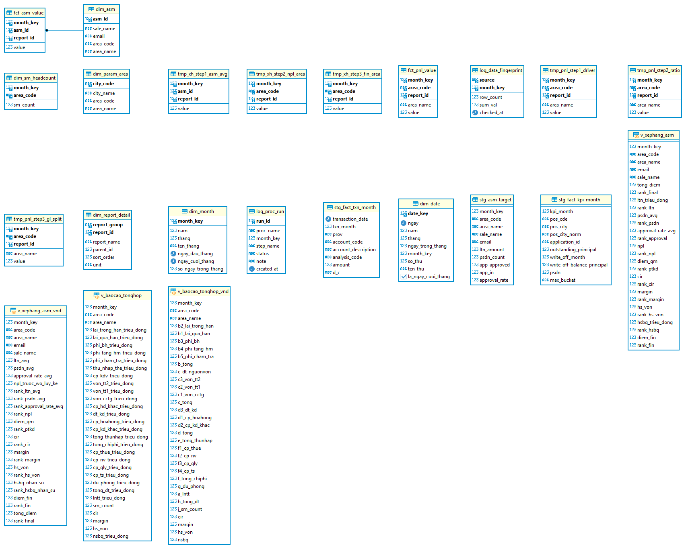

<div align="center">

# Tracking Business Metrics And Evaluating Credit Card Sales Team Performance

**Ngôn ngữ / Language**: [Tiếng Việt](README.md) · **English**

[Email](mailto:tranduc22104@gmail.com) · [LinkedIn](https://www.linkedin.com/in/tr%E1%BA%A7n-ng%E1%BB%8Dc-%C4%91%E1%BB%A9c-48b3a7439/)

<p>
  
  
  
  
</p>

</div>

## 📑 Table Of Contents

1. [🏢 Business Context And Executive Requirements](#1--business-context-and-executive-requirements)
2. [🎯 Defining System "Outputs" (Output-First Thinking)](#2--defining-system-outputs-output-first-thinking)
3. [🔍 Data Discovery, Sourcing, And Gap Analysis](#3--data-discovery-sourcing-and-gap-analysis)
4. [🧮 Pipeline Architecture And Formula Design](#4--pipeline-architecture-and-formula-design)
5. [🖥️ Visualization And Business Requirement Fulfillment](#5-️-visualization-and-business-requirement-fulfillment)
6. [📊 Post-Visualization Data Insights And Strategic Recommendations](#6--post-visualization-data-insights-and-strategic-recommendations)
7. [📚 Practical Implementation Lessons](#7--practical-implementation-lessons)
8. [🗄️ Data Warehouse Architecture](#8-️-data-warehouse-architecture)
9. [🛠️ Tools And Technologies Used](#9-️-tools-and-technologies-used)
10. [📂 Project Structure](#10--project-structure)
11. [🔒 Data Provenance And Usage Rights](#11--data-provenance-and-usage-rights)
12. [📖 Handover Documentation](#12--handover-documentation)
13. [💼 Applied Project Skills](#13--applied-project-skills)
14. [👤 Author](#14--author)

---

## 1. 🏢 Business Context And Executive Requirements

### Real-world situation in the credit card division
The bank's credit card division operates across **7 business regions**, managed directly by a field leadership network of **74 to 84 Area Sales Managers (ASMs)** depending on the period. In periodic executive committee meetings, leadership faced two chronic managerial dilemmas:

1. **True regional profitability was obscured:**
   In the general accounting ledger, business regions directly record interest income and card issuance fees. However, major operating expenses such as funding costs, central marketing campaigns, core technology infrastructure, and back-office support salaries are booked under the Head Office pool. Without an equitable, driver-based cost allocation mechanism, standard reporting showed every region as profitable, masking territories that were actually eroding overall bank value.

2. **Sales personnel evaluation incentivized credit risk expansion:**
   When Area Sales Managers were evaluated purely on gross new lending volume or active card counts, managers were naturally incentivized to lower underwriting standards to hit short-term targets. As a consequence, volume expanded rapidly in early months, but non-performing loan (NPL) ratios and provision charges surged in subsequent periods.

### Executive mandate assigned to the Data Analyst
Executive Leadership commissioned the Data Analyst to design and build an automated monthly management reporting system to:
- Allocate Head Office revenues and expenses across the 7 regions using economically sound, auditable allocation drivers.
- Establish a balanced ranking scorecard for Area Sales Managers that evaluates **Commercial Scale** alongside **Credit Risk Discipline and Financial Efficiency**.
- Deliver an interactive analytical dashboard for executive decision-makers while retaining cell-level Excel reconciliation models for Accounting and Finance.

---

## 2. 🎯 Defining System "Outputs" (Output-First Thinking)

Starting from executive requirements, the Analyst employed an **Output-First design methodology** (reverse-engineering from desired deliverables) to map out the required deliverables:

```text
┌────────────────────────────────────────────────────────────────────────────────────────┐
│                              DESIRED BUSINESS DELIVERABLES                             │
├────────────────────────────────────────┬───────────────────────────────────────────────┤
│ 7-REGION P&L MANAGEMENT REPORT         │ ASM BALANCED SCORECARD RANKING                │
│ • Separate direct vs. allocated items  │ • Independent 2-pillar assessment: Scale vs.  │
│ • Decompose 6 revenue/cost drivers     │   Financial Efficiency & Credit Risk Control  │
│ • Isolate standalone monthly flows     │ • Prevent loosening credit to chase volume    │
│ • 100% reconciliation with GL totals   │ • Fair, transparent scoring for 74-84 ASMs    │
├────────────────────────────────────────┴───────────────────────────────────────────────┤
│ DUAL DELIVERY FORMATS                                                                  │
│ • Interactive Power BI Dashboard: For executive KPI tracking & variance diagnosis      │
│ • Standardized Excel Workbooks: For accounting reconciliation with preserved formulas  │
└────────────────────────────────────────────────────────────────────────────────────────┘
```

### Concrete output specifications:
1. **Monthly Flow Variance Decomposition:** De-accumulate year-to-date (YTD) balances into standalone monthly figures, decomposing net variance across 6 core accounting items: Gross Card Income, Funding Cost, Other Operating Expense, General Admin Expense, Risk Provision Expense, and Rounding Residuals.
2. **Profit–Risk Quadrant Matrix:** Map the 7 regions across 4 distinct operational playbooks based on two dimensions: Standalone Monthly Profit and Non-Performing Loan (NPL) Ratio.
3. **Multi-dimensional ASM Scorecard:** Score each Area Sales Manager across 8 metrics balancing personal performance (new loan sales, active cards, approval rates) with territory health (regional NPL ratio, CIR, Margin, return on capital, profit per manager).

---

## 3. 🔍 Data Discovery, Sourcing, And Gap Analysis

To produce the specified deliverables, the Analyst conducted an audit of operational data sources across multiple banking departments:

| Source Department | Data Asset | Volume | Characteristics |
|---|---|---:|---|
| **Finance & Accounting** | General Accounting Ledger (`fact_txn_month`) | **63,134** entries | Detailed journal entries: 62,953 direct regional entries with specific province codes and 181 shared entries centralized at Head Office (province code `'00'`). |
| **Card Operations** | Contract Card Statement Extracts (`fact_kpi_month`) | **2,932,914** rows | Granular loan balances by delinquency bucket (Groups 1 to 5), written-off accounts, active revolving card counts, and transactional volumes over 5 months. |
| **Branch Network Management** | Monthly ASM Target Sheets (`kpi_asm_data`) | **420** rows | Monthly target and actual tracking of new loan sales, active card volumes, and application approval rates for each Area Sales Manager. |
| **Planning & Data Governance** | Parameter & Mapping Templates | **64** provinces | Province-to-region mapping table grouping 64 provinces into 8 territories (Head Office `'A'` and 7 business regions `'B'..'H'`) with reference financial templates. |

### Gap Analysis & Data Challenges
The data audit revealed three technical obstacles that needed resolution prior to calculation:
1. **Massive Contract File Exceeding Standard Tools:** With nearly 3 million rows and a 117.2 MB file size, standard spreadsheet applications crashed or ran out of memory.
2. **Pivoted Wide-Format Target Data:** The ASM target sheet formatted monthly figures horizontally across columns, making direct SQL joins with transactional fact tables impossible.
3. **Dimension Inconsistencies Across Systems:** Province naming conventions diverged across source systems (e.g., "Bà Rịa - Vũng Tàu" in statements vs. "Vũng Tàu" in parameters), which would have dropped over 36,000 contract rows when computing the Southeast region's NPL ratio.

---

## 4. 🧮 Pipeline Architecture And Formula Design

### 4.1. Engineering an automated 4-stage processing pipeline
To replace manual spreadsheets, the Analyst designed an end-to-end data pipeline:

<div align="center">


</div>

- **Stage 1 (Data Ingestion):** Ingest 3 raw operational files and 1 parameter workbook.
- **Stage 2 (Cleansing & Ingestion with Python):** Stream raw XML directly from zipped `.xlsx` containers via `openpyxl`, `zipfile`, and `xml.etree` without RAM bloat; standardize province naming keys (`pos_city_norm`); unpivot horizontal targets into vertical records and populate 3 `staging` tables (`stg_fact_kpi_month`, `stg_fact_txn_month`, `stg_asm_target`) along with 2 dimension tables (`dim_area`, `dim_param_area`).
- **Stage 3 (Warehouse Calculations in PostgreSQL):** Orchestrate 9 `stored procedures` to execute multi-step cost allocations and ranking algorithms, recording audit steps into 6 intermediate `tmp_` tables and persisting official results into 2 vertical `fact` tables (`fct_pnl_value`, `fct_asm_value`).
- **Stage 4 (Reporting & Governance):** Deploy the Power BI semantic model (`Import` mode, 72 DAX `measures`) and automate formatted Excel workbook generation via `run_report.py`.

### 4.2. Designing Head Office Cost Allocation Formulas (P&L Problem)
Two management accounting rules were defined to process the 63,134 ledger entries:
- **Rule 1 (Direct Assignment):** Ledger entries with specific province codes are assigned 100% to the region managing that territory.
- **Rule 2 (Driver-Based Allocation):** Centralized Head Office entries (province `'00'`, region `'A'`) are distributed across the 7 regions according to their share of business drivers:

$$\text{Allocation Ratio for Region } i = \frac{\text{Driver Value for Region } i}{\sum_{k=1}^7 \text{Driver Value for Region } k}$$

*Driver Alignment:* Funding costs are allocated by Group 1 balances; shared loan-loss provisions by Group 2–5 balances plus write-offs; operating overhead by manager headcount or active card counts.

### 4.3. Designing the ASM Balanced Scorecard Formula (Ranking Problem)
To balance growth with risk control, the scorecard evaluates 8 metrics across **2 independent pillars**:

```text
┌────────────────────────────────────────────────────────────────────────────────────────┐
│                               ASM BALANCED EVALUATION SYSTEM                           │
├──────────────────────────────────────────┬─────────────────────────────────────────────┤
│ PILLAR 1: COMMERCIAL SCALE (diem_qm)     │ PILLAR 2: FINANCIAL EFFICIENCY (diem_fin)   │
│ • Cumulative Avg New Loan Sales (Higher) │ • Cost-to-Income Ratio - CIR (Lower better) │
│ • Cumulative Avg Active Cards (Higher)   │ • Profit Margin (Higher better)             │
│ • Cumulative Avg Approval Rate (Higher)  │ • Return on Capital Factor (Higher better)  │
│ • REGIONAL NPL RATIO (Lower is better)   │ • Profit per Manager (Higher better)        │
│   (Acts as an automatic risk brake)      │   (Aligns manager with regional health)     │
└──────────────────────────────────────────┴─────────────────────────────────────────────┘
```

Because component metrics use different measurement units, the algorithm **ranks each metric independently (Rank 1 is best) and sums the ranks into a composite score**:
$$\text{Total Score} = \text{Scale Score } (diem\_qm) + \text{Financial Score } (diem\_fin)$$
*A lower composite score indicates a higher overall bank-wide ranking.*

---

## 5. 🖥️ Visualization And Business Requirement Fulfillment

### Interactive Power BI Architecture
The dashboard semantic model features **5 specialized analytical pages**, running on `Import` mode across 4 warehouse tables and 72 DAX `measures`:
1. **Executive Summary:** High-level overview of portfolio growth and budget attainment.
2. **Data Glossary:** Standardized business definitions and technical formulas for all KPIs.
3. **Regional P&L Performance:** Post-allocation profit-and-loss statements and month-over-month variance drivers.
4. **ASM Performance Leaderboard:** Granular rankings, composite scores, and period-over-period rank shifts for all 84 managers.
5. **Advanced Diagnostics & Recommendations:** Dynamic heatmap tables and quadrant scatter plots pinpointing operational anomalies.

### Evaluation of Business Requirement Fulfillment
The deployed solution resolved all initial executive requirements:
- **Absolute Data Integrity:** 4 verification layers and 91 automated cross-reconciliation tests between Power BI DAX and PostgreSQL SQL confirmed 0 discrepancies. The sum across all 7 regions reconciles 100% with the general ledger.
- **Fair, Objective Evaluation:** Integrating regional NPL into the commercial scale pillar effectively curbed aggressive lending volume expansion at the expense of loan quality.
- **Serving Diverse Departmental Workflows:** Satisfied executive needs with responsive visual analytics while providing finance teams with cell-by-cell Excel workbooks preserving bank-standard formulas.

---

## 6. 📊 Post-Visualization Data Insights And Strategic Recommendations

As of May 2023 (5/2023), cumulative profit before tax reached **250,450.06 million VND**, with standalone May profit expanding by **+4,390.9 million VND (+8.4%)** versus April. However, deeper visual diagnosis revealed critical underlying dynamics:

| Business Regions | ASM Team Size (May) | Analysis Horizon | Processed Data Scale | 5-Month Cumulative Profit | May vs. April (Month 5 vs. 4) Profit Variance |
| :---: | :---: | :---: | :---: | :---: | :---: |
| **7 regions** | **84 managers** | **5 months** (month 1 – month 5/2023) | **2,996,476 rows** | **250,450.06 million VND** | **+4,390.9 million VND (+8.4%)** |

### Key Analytical Findings
1. **System-wide +8.4% profit growth was not driven by core sales momentum:**
   Approximately **97.2%** of the bank's total monthly profit growth was concentrated in **Southwest** (+4,267.8 million VND). Yet net operating income from cards only edged up by +16.3 million VND, while operating expenses reduced profit by −195.9 million VND. Virtually the entire profit surge stemmed from **risk provision expenses decreasing by +4,447.3 million VND**. Crucially, Southwest carried the **highest NPL ratio across all 7 regions (21.99%)** and had zero managers in the bank-wide top 25.
2. **Southeast posted losses due to bad debt provisioning, despite strong top-line sales:**
   Southeast recorded a monthly loss of **−8,787.4 million VND**. Granular decomposition showed that the sales force generated solid commercial traction (**net operating income grew +3,210.7 million VND**), but this was completely erased by **provision expenses surging by −3,234.2 million VND**, pushing 16 out of 19 ASMs into the bottom 24 positions bank-wide.
3. **Core revenue contraction was masked by provision relief in Red River Delta:**
   Monthly profit in Red River Delta expanded by +1,310.9 million VND purely due to a +1,455.8 million VND provision drop, whereas underlying net operating income fell by −232.2 million VND, indicating slowing commercial demand in the bank's largest market.
4. **Benchmark operational quality achieved in South Central Coast:**
   Despite small headcount (5 ASMs), South Central Coast maintained the lowest NPL ratio bank-wide (**11.24%**) and placed **4 out of 5 ASMs** in the top 25 rankings.

### Five Strategic Action Items for Executive Leadership
Based on data evidence, the Analyst presented 5 concrete operational recommendations:

| # | Action Item | Data Evidence (May 2023 / 5/2023) | Responsible Unit · Timeline |
|:---:|:---|:---|:---|
| 01 | Separate gross provision charges from provision reversals; introduce pre-tax profit excluding reversals | Current reporting shows only net provisions, obscuring underlying commercial trends | Risk Management Division · Month 6 |
| 02 | Audit loan cohorts migrating into higher delinquency buckets in Southeast, Northeast, and Northwest | Provision expenses across these 3 regions jumped by **6,035.1 million VND** in May | Regional ASMs + Risk Management · 30 days |
| 03 | Conduct on-site inspections of underwriting and recovery operations in Southwest | NPL reached **21.99%** (highest in the bank) while accounting for **97.2%** of reported profit growth | Sales Division + Risk Management · Month 7 |
| 04 | Conduct controlled pilot testing of South Central Coast's underwriting practices across select branches | Lowest NPL ratio bank-wide (**11.24%**) and 4/5 ASMs in the top 25 | Sales Division · Review in 2 months |
| 05 | Adjust bonus formulas: Combine net operating income with NPL ratios rather than single-month profit flow | Prevents misallocating performance bonuses to territories benefiting from temporary provision drops | Executive Board · Immediate |

---

## 7. 📚 Practical Implementation Lessons

1. **Adopt an "Output-First" mindset before touching data:** Defining exact reporting deliverables and decision questions upfront ensures the Analyst collects only relevant fields and avoids aimless ETL iterations.
2. **Master management accounting logic before writing SQL queries:** In banking analytics, understanding why funding costs carry negative ledger balances or why Head Office carries province code `'00'` and region code `'A'` is essential for building accurate SQL allocation procedures.
3. **Dimension cleansing protects reporting integrity:** Catching spelling discrepancies between "Bà Rịa - Vũng Tàu" and "Vũng Tàu" during data ingestion prevented losing over 36,000 contracts and preserved the accuracy of the Southeast region's credit metrics.
4. **Never assess business performance through a single aggregate figure:** A positive headline profit can easily mask contracting core commercial revenues or deteriorating credit quality. Component decomposition and multi-dimensional analysis are fundamental to professional data storytelling.

---

## 8. 🗄️ Data Warehouse Architecture

The data warehouse follows a `Star Schema` design within the `banking_project` schema comprising **19 tables and 4 `views`**:

| Layer | Count | Object List and Row Counts | Role |
|---|---:|---|---|
| **Dimension (`dim_`)** | 7 | `dim_area` (8) · `dim_param_area` (64) · `dim_asm` (84) · `dim_month` (5) · `dim_date` (151) · `dim_report_detail` (50) · `dim_sm_headcount` (35) | Serves as authoritative dimensions: region catalog, province-to-region mapping, ASM roster, date/month axes, and 50-item report tree. |
| **Staging (`stg_`)** | 3 | `stg_fact_kpi_month` (2,932,922) · `stg_fact_txn_month` (63,134) · `stg_asm_target` (420) | Stores unmodified operational extracts from source departments for auditability. |
| **Intermediate (`tmp_`)** | 6 | `tmp_pnl_step1_driver` (315) · `tmp_pnl_step2_ratio` (560) · `tmp_pnl_step3_gl_split` (535) · `tmp_xh_step1_asm_avg` (1,164) · `tmp_xh_step2_npl_area` (105) · `tmp_xh_step3_fin_area` (315) | Holds step-by-step intermediate calculation results, enabling instant debugging via DBeaver. |
| **Fact (`fct_`)** | 2 | `fct_pnl_value` (1,115) · `fct_asm_value` (8,536) | Stores official unpivoted results (Tall format), allowing easy metric additions without altering database schemas. |
| **Audit Log (`log_`)** | 1 | `log_proc_run` (95) | Tracks execution timestamps, procedure statuses, and transactional integrity. |
| **Reporting Views (`v_`)** | 4 | `v_baocao_tonghop` (35) · `v_baocao_tonghop_vnd` (35) · `v_xephang_asm` (388) · `v_xephang_asm_vnd` (388) | Pivots tall fact tables into wide formats tailored for Power BI and automated Excel export. |

<div align="center">



</div>

---

## 9. 🛠️ Tools And Technologies Used

| Technical Task | Tool Selected | Practical Rationale |
|---|---|---|
| Streaming 3M-row Excel files, unpivoting targets, and cleansing dimension strings | Python 3.10 (`openpyxl`, `psycopg2`, XML streaming) | Streams zipped XML directly without RAM exhaustion; bulk-loads data into PostgreSQL via `COPY`. |
| Central storage, 2-rule cost allocation, and multi-step ranking algorithms | PostgreSQL 16, PL/pgSQL (`stored procedure`) | Robust support for `Window Function` (`RANK()`), `CTE` (`WITH`), and transaction safety without partial commits. |
| Schema management, relationship visualization, and intermediate step auditing | DBeaver | Visualizes 23 objects with 9 `Virtual Foreign Keys`; supports fast inspection of intermediate `tmp_` tables. |
| Interactive dashboards, variance decomposition, and diagnostic storytelling | Power BI Desktop (`Import` mode), 72 DAX `measures` | Optimized month-filtering speed; renders dynamic heatmap matrices and scatter plots. |

<div align="center">

<p>
  
  
  
  
  
</p>

</div>

---

## 10. 📂 Project Structure

```text
.
├── input/              # Stores parameter and template files; 3 raw data files exceed GitHub limits and are kept locally
│   └── Tham so va mau doi chieu.xlsx  # 64-province mapping table, GL mapping, and official reporting templates
├── ingestion/          # Python extraction, cleansing, database loading, and automated report generation
│                       # db_config.example.py — sample database connection template
│                       # run_all.py orchestrates 4 load steps · run_report.py generates formatted Excel reports
├── sql/                # Structured SQL codebase organized by architectural layer:
│   ├── dim/            #   dim_month_headcount (time and headcount axes), dim_asm, dim_report_detail (50 KPIs)
│   ├── tmp/            #   tmp_pnl_step, tmp_xh_step — 6 intermediate step tables with dedicated procedures
│   ├── fct/            #   fct_pnl_allocation (Rules 1 & 2), fct_xephang_asm (2 pillars) — 2 fact tables & orchestrators
│   └── rpt/            #   rpt_pnl_view, rpt_xephang_view — 4 reporting views for Power BI and Excel
├── output/             # Final deliverables: Cumulative Excel Workbooks and Power BI Report (.pbix)
├── images/             # Pipeline diagrams, warehouse schemas, and dashboard screenshots
├── docs/               # Technical documentation: HIEN_TRANG_HE_THONG, PIPELINE, NHAT_KY_CONG_VIEC, LOI_THUONG_GAP
├── requirements.txt    # Required Python libraries: psycopg2-binary and openpyxl
├── README.md           # Vietnamese project case study (default landing page)
└── README_eng.md       # English project case study
```

---

## 11. 🔒 Data Provenance And Usage Rights

- The operational datasets utilized in this project are **real commercial banking data provided and authorized by the institution** for research and portfolio demonstration.
- **Repository Storage Policy:** Due to GitHub's 100 MB per-file upload policy, the raw card statement file weighing **117.2 MB** is managed locally alongside two other raw transactional files. The repository retains **`Tham so va mau doi chieu.xlsx`** (127,976 bytes) containing mapping parameters and template layouts, enabling external reviewers to audit all code, calculation logic, and reporting models.

---

## 12. 📖 Handover Documentation

Comprehensive system documentation is maintained within the `docs/` directory:
- [`docs/HIEN_TRANG_HE_THONG.md`](docs/HIEN_TRANG_HE_THONG.md) — Warehouse status, row counts across 19 tables and 4 `views`, file ownership matrix, and reconciliation benchmarks.
- [`docs/PIPELINE.md`](docs/PIPELINE.md) — 4-stage processing pipeline specifications and operational execution guides.
- [`docs/NHAT_KY_CONG_VIEC.md`](docs/NHAT_KY_CONG_VIEC.md) — Worklog recording implementation steps, testing phases, and optimization history.
- [`docs/LOI_THUONG_GAP.md`](docs/LOI_THUONG_GAP.md) — Troubleshooting manual cataloging **58 real-world error cases** spanning source data, SQL syntax, Python logic, and DAX expressions.

---

## 13. 💼 Applied Project Skills

<div align="center">

`Business Problem Framing` · `Output-First Solution Design` · `Bank Management Accounting` ·  
`Multi-Driver Cost Allocation` · `Profit Variance Decomposition` · `Star Schema Modeling` ·  
`Advanced SQL & PL/pgSQL (Stored Procedures, Window Functions)` · `Large-Scale Data Engineering with Python` ·  
`Power BI (Import Mode) & Advanced DAX` · `Automated Reconciliation & Data Governance`

</div>

---

## 14. 👤 Author

<div align="center">

**Tran Ngoc Duc** · Data Analyst · Business Intelligence · Data Science · Management Information Systems · Operations

*Management accounting analytics · Performance measurement frameworks · End-to-end data reconciliation*

[📧 tranduc22104@gmail.com](mailto:tranduc22104@gmail.com) · [💼 LinkedIn](https://www.linkedin.com/in/tr%E1%BA%A7n-ng%E1%BB%8Dc-%C4%91%E1%BB%A9c-48b3a7439/)

</div>
