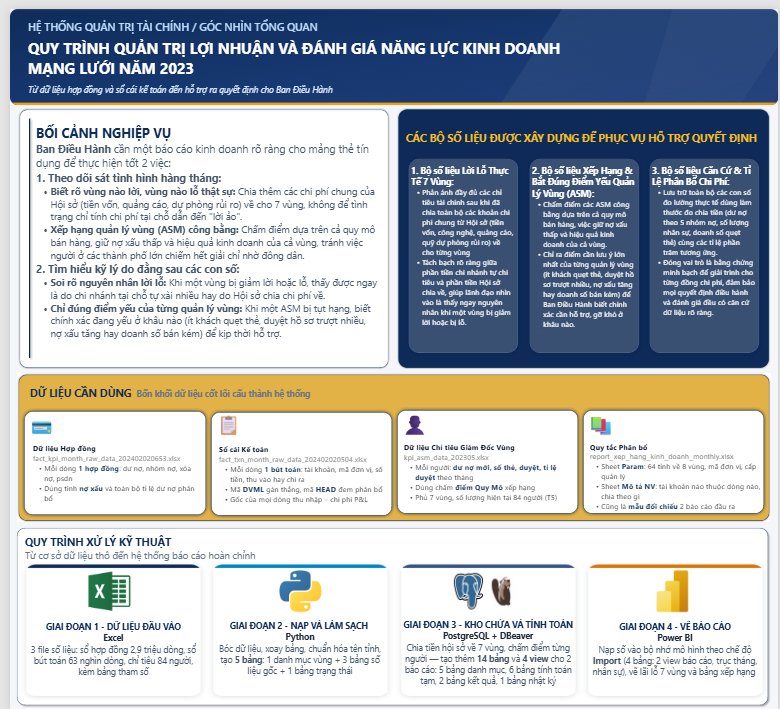
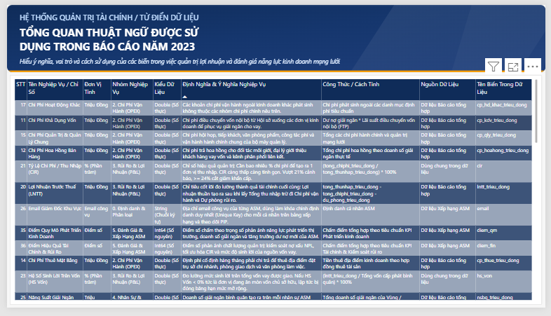
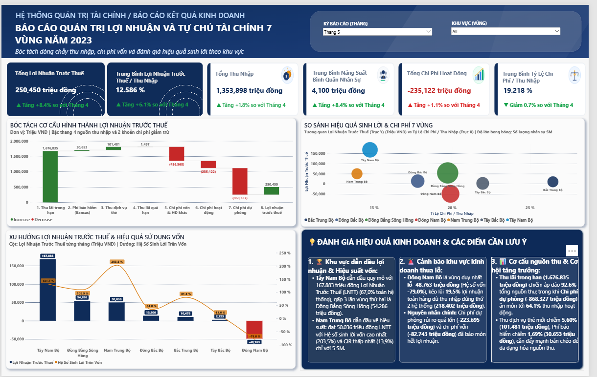
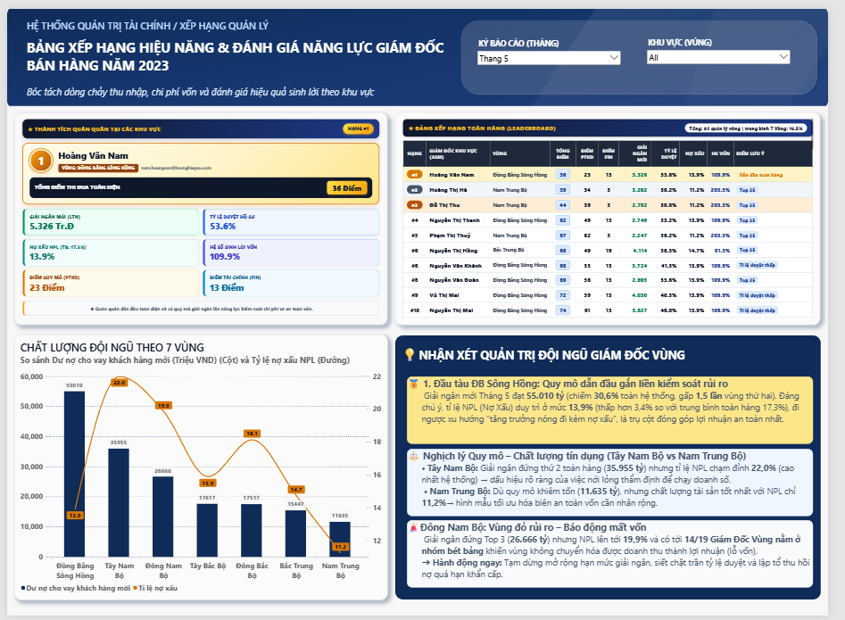
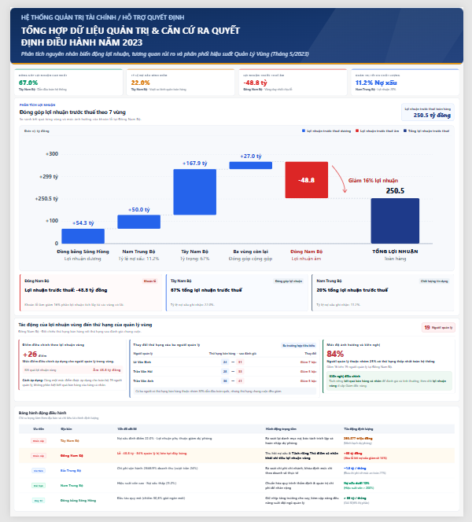

<div align="center">

# Building Credit Card Business Management Reporting And Ranking Regional Sales Management Performance

**Ngôn ngữ / Language**: [Tiếng Việt](README.md) · **English**

[Email](mailto:tranduc22104@gmail.com) · [LinkedIn](https://www.linkedin.com/in/tr%E1%BA%A7n-ng%E1%BB%8Dc-%C4%91%E1%BB%A9c-48b3a7439/)

<p>
  
  
  
  
</p>

</div>

## 📑 Table Of Contents

1. [🏢 Business Context And Executive Requirements](#1--business-context-and-executive-requirements)
2. [🎯 Requirement Analysis And Report Output Design](#2--requirement-analysis-and-report-output-design)
3. [🔍 Data Discovery And Assessment](#3--data-discovery-and-assessment)
4. [🔄 Data Engineering And Warehouse Architecture](#4--data-engineering-and-warehouse-architecture)
5. [🧮 Business Logic And Metric Design](#5--business-logic-and-metric-design)
6. [🧪 Data Validation And Quality Assurance](#6--data-validation-and-quality-assurance)
7. [🖥️ Dashboard Design And Visualization In Power BI](#7-️-dashboard-design-and-visualization-in-power-bi)
8. [📊 Business Insights And Management Recommendations](#8--business-insights-and-management-recommendations)
9. [📚 Lessons Learned And Implementation Takeaways](#9--lessons-learned-and-implementation-takeaways)
10. [🛠️ Tools And Technologies](#10-️-tools-and-technologies)
11. [📂 Project Repository Structure](#11--project-repository-structure)
12. [🔒 Data Provenance And Usage Rights](#12--data-provenance-and-usage-rights)
13. [📖 Handover Documentation](#13--handover-documentation)
14. [👤 Author](#14--author)

---

## 1. 🏢 Business Context And Executive Requirements

Across the bank's credit card operations, distribution networks are structured into **7 business regions**, managed directly by a field leadership network of **74 to 84 Area Sales Managers (ASMs)** depending on the period. In periodic executive committee meetings, leadership consistently faced chronic managerial dilemmas arising from conventional reporting methods:

1. **True economic profitability was obscured:**
   In general accounting ledgers, business regions directly record revenue from loan interest and card fees. However, major operating expenses such as funding costs, central marketing campaigns, core technology infrastructure, and back-office support salaries are booked centrally under the Head Office pool. Without an equitable, driver-based cost allocation mechanism, conventional reporting showed every region as profitable, masking territories that were actually eroding overall bank value.

2. **Sales personnel evaluation incentivized credit risk expansion:**
   When Area Sales Managers were evaluated purely on gross new lending volume or active card issuance counts, managers were naturally incentivized to lower underwriting standards to hit short-term targets. As a consequence, volume expanded rapidly in early months, but non-performing loan (NPL) ratios and provision charges surged in subsequent periods.

3. **Limitations of conventional reporting:**
   Standard financial accounting reports only provided static year-to-date (YTD) aggregates, lacking the capability to decompose monthly variations or differentiate between profit growth driven by core commercial expansion versus reductions in credit provision charges.

Addressing these management dilemmas, Executive Leadership formulated 5 key business questions:

| Management Dilemma | Core Question To Address | Objective To Achieve |
|---|---|---|
| **Commercial Performance** | Which regions are genuinely profitable after absorbing central costs? | Determine accurate 7-region P&L after Head Office allocation |
| **Profit Variance** | What causes monthly profit fluctuations across regions? | Decompose profit flow into core revenue and cost components |
| **Credit Quality** | Which regions carry elevated credit risks threatening capital safety? | Monitor credit balances across 5 debt buckets and regional NPL ratios |
| **Managerial Performance** | Which ASMs demonstrate strong commercial growth alongside risk discipline? | Build an equitable multi-dimensional ranking system for 74 - 84 managers |
| **Executive Governance** | How should performance metrics be delivered for timely decision-making? | Build an interactive executive dashboard and audit-grade reconciliation models |

---

## 2. 🎯 Requirement Analysis And Report Output Design

Upon receiving executive directions, the primary challenge was that requirements were framed as high-level governance objectives without pre-existing reporting templates or technical specifications. Therefore, the approach began with **Output-First thinking (reverse-engineering from business decision needs)**: determining the critical management perspectives required by leadership before searching for data.

### Mapping executive requirements to concrete report deliverables:

| Executive Requirement | Deliverable To Engineer | Information Displayed |
|---|---|---|
| **Monitor True P&L** | 7-Region Management P&L Report | Net card income, cost of funds, operating expenses, provision charges, profit before tax (PBT) |
| **Decompose Variance** | Monthly Profit Flow Waterfall | Month-over-month (MoM) variance decomposing 6 revenue and cost drivers |
| **Monitor Credit Risk** | Profit – Risk Quadrant Matrix | Classify 7 regions into 4 strategic governance quadrants along Profit and NPL axes |
| **Evaluate Sales Managers** | ASM Balanced Scorecard | 8 indicators evaluated across 2 independent pillars (Commercial Scale vs Financial Efficiency/Risk) |
| **Multi-Tier Delivery** | Integrated Reporting Ecosystem | Interactive Power BI dashboard for executives; cell-level Excel reconciliation workbook for finance |

### Logical architecture from business requirements to reporting deliverables:

```text
┌────────────────────────────────────────────────────────────────────────────────────────┐
│                              EXECUTIVE GOVERNANCE REQUIREMENTS                         │
│   1. Measure true economic regional P&L  │   2. Establish balanced ASM scorecards      │
└───────────────────────────────────┬────────────────────────────────────────────────────┘
                                    │ (Output-First Design Methodology)
                                    ▼
┌────────────────────────────────────────────────────────────────────────────────────────┐
│                                TARGET REPORTING OUTPUT GROUPS                          │
├────────────────────────────────────────┬───────────────────────────────────────────────┤
│ GROUP 1: REGIONAL MANAGEMENT P&L       │ GROUP 2: ASM PERFORMANCE RANKING              │
│ • Gross card income, funding cost,     │ • Individual sales volume: Gross lending,     │
│   operating expense, loan provisions   │   active credit cards, approval rate          │
│ • Head Office cost allocation drivers  │ • Territorial stewardship: Regional NPL,      │
│ • Monthly profit variance decomposition│   regional CIR, Margin, average profit / ASM  │
└───────────────────────────────────┬────────────────────────────────────────────────────┘
                                    │ (Translation to visual delivery layer)
                                    ▼
┌────────────────────────────────────────────────────────────────────────────────────────┐
│                          POWER BI MANAGEMENT DASHBOARD (5 PAGES)                       │
│ • Page 1: Executive Overview           │ • Page 4: ASM Ranking Scorecard               │
│ • Page 2: Data Glossary                │ • Page 5: Deep-Dive Diagnosis & Root Cause    │
│ • Page 3: Regional P&L Management      │ + 7-Sheet Excel Accounting Reconciliation Model│
└────────────────────────────────────────────────────────────────────────────────────────┘
```

### Functional distinction between metric groups:
- **Commercial Performance Metrics (P&L, Regional NPL, CIR, Margin):** Measure the comprehensive financial viability of geographic territories after absorbing indirect Head Office costs, informing capital allocation and credit limit governance.
- **Managerial Performance Metrics (8-Indicator ASM Ranking):** Balance individual sales achievement against regional risk discipline to encourage sustainable growth, disincentivizing loose credit standards for short-term volume.

---

## 3. 🔍 Data Discovery And Assessment

The bank lacked a centralized data mart or a single comprehensive table capable of satisfying the target outputs. After establishing target deliverables, an active cross-departmental data discovery process was undertaken to gather the required operational data components:

| Supplying Department | Source Dataset | Volume | Role In Fulfilling Desired Outputs |
|---|---|---:|---|
| **Accounting & Finance** | General Ledger (`fact_txn_month`) | **63,134** entries | Captures line-item revenue and cost entries; includes 62,953 branch-tagged entries (direct regional assignment) and 181 centralized Head Office entries (pool `'00'`, requiring allocation). |
| **Card Operations** | Card Contract Statements (`fact_kpi_month`) | **2,932,914** rows | Records customer-level credit balances across 5 debt buckets, written-off accounts, and turnover across 5 months; serves as the basis for regional NPL calculation and allocation driver ratios. |
| **Network Sales Management** | Commercial Target Sheet (`kpi_asm_data`) | **420** rows | Tracks individual monthly sales targets: gross lending volume, active card count, and credit approval rates for 74 to 84 Area Sales Managers. |
| **Planning & Data Governance** | Parameter Matrix & Template Mapping | **64** provinces | Maps 64 administrative provinces into 8 geographic management zones (Head Office `'A'` and 7 regions `'B'..'H'`) with standardized reporting layouts. |

### Data Gap Analysis:

| Target Deliverable | Required Data Inputs | Available Source Data | Data Assessment |
|---|---|---|---|
| **7-Region P&L Report** | Itemized income/expense, branch province codes, GL accounts | General Ledger and Regional Parameter Matrix | **Fully Satisfied**, but 181 Head Office entries require indirect allocation algorithms |
| **NPL & Risk Analysis** | Credit balances across 5 buckets, written-off debt | 2.93M-row card contract statements | **Fully Satisfied** at regional level across 5 operating months |
| **ASM Ranking Scorecard** | Individual sales targets, approval rates, personnel data | ASM Commercial Target Sheet | **Fully Satisfied** for 8 designed indicators |
| **Individual ASM NPL Tracking**| Delinquent balances tagged directly to employee IDs | Statements contain branch codes, not employee IDs | **Partially Satisfied**: Regional NPL and financial metrics are calculated territory-wide and shared among ASMs in the same region |

### Technical barriers identified in raw data:
1. **Card statement data exceeded desktop spreadsheet limits:** Containing nearly 3 million rows and weighing **117.2 MB**, the statement file crashed conventional spreadsheet tools and exhausted memory.
2. **Unpivoted wide-format target data:** The ASM target worksheet arranged monthly metrics across horizontal columns, preventing direct relational ingestion and table joins.
3. **Entity resolution mismatch across systems:** Geographic naming inconsistencies (e.g., statements recording "Bà Rịa - Vũng Tàu" vs. parameter tables recording "Vũng Tàu") would drop over **36,000 credit card accounts** if joined directly, distorting Southeast regional NPL figures.

---

## 4. 🔄 Data Engineering And Warehouse Architecture

To transform multi-source raw files into an operational reporting system, an automated end-to-end 4-stage pipeline was engineered:

<div align="center">


</div>

### Detailed engineering steps:

- **Stage 1 – Data Ingestion (Python Streaming Ingestion):**
  Utilized Python libraries (`openpyxl` combined with `zipfile` + `xml.etree` streaming parsing) to read the **117.2 MB** statement file containing nearly 3 million rows without memory overflows. Unpivoted the wide-format ASM target worksheet into normalized relational rows.

- **Stage 2 – Data Cleaning (Standardization and Quality Enforcement):**
  Enforced strict data types; handled null values; implemented Vietnamese text normalization (`pos_city_norm`) to resolve province naming mismatches, salvaging 36,000 credit card contracts. Loaded clean data into 3 staging tables (`stg_fact_kpi_month`, `stg_fact_txn_month`, `stg_asm_target`) and 2 regional dimension tables (`dim_area`, `dim_param_area`).

- **Stage 3 – Data Warehouse Design (Kimball Star Schema in PostgreSQL):**
  Structured within schema `banking_project` encompassing **19 tables and 4 `views`**:
  - **7 Dimension Tables (`dim_`):** `dim_area` (8 zones), `dim_param_area` (64 provinces), `dim_month` (5 months), `dim_asm` (84 personnel), `dim_report_detail` (50 metrics), `dim_month_headcount` (35 rows), `dim_sm_headcount` (35 rows).
  - **3 Staging Tables (`stg_`):** `stg_fact_kpi_month` (2,932,922 rows), `stg_fact_txn_month` (63,134 rows), `stg_asm_target` (420 rows).
  - **6 Temporary Processing Tables (`tmp_`):** Unified vertical schema (`month_key`, `area_code`, `report_id`, `value`) storing intermediate computations for P&L (`tmp_pnl_step1..3`) and Ranking (`tmp_xh_step1..3`).
  - **2 Core Fact Tables (`fct_`):** `fct_pnl_value` (1,115 rows) storing regional P&L results and `fct_asm_value` (8,536 rows) storing ASM ranking scores across 5 months.
  - **1 Audit Log Table (`log_`):** `log_proc_run` recording procedure execution history (65 `START` and `OK` entries, 0 `FAIL` entries).
  - **9 `Virtual Foreign Keys`:** Documenting relational integrity in DBeaver diagrams without degrading transactional batch ingestion speeds.

<div align="center">


</div>

- **Stage 4 – Data Processing (PL/pgSQL Stored Procedures):**
  Engineered 9 stored procedures executing allocation logic and ranking algorithms. Encapsulated processing in atomic transactions with automated error trapping and rollback safeguards.

---

## 5. 🧮 Business Logic And Metric Design

### 5.1. Track A – Regional Management P&L Calculation

The allocation engine processes 63,134 ledger transactions through 2 managerial accounting rules:

- **Rule 1 (Direct Branch Assignment):** Transactions containing designated province codes (62,953 rows) are assigned 100% to their corresponding operational region.
- **Rule 2 (Indirect Central Allocation):** Central Head Office transactions (181 pooled expense lines, province `'00'`, zone `'A'`) are distributed across the 7 regions using driver ratios:

$$	ext{Allocation Ratio for Region } i = rac{	ext{Driver Metric Value for Region } i}{\sum_{k=1}^7 	ext{Driver Metric Value for Region } k}$$

$$	ext{Allocated Cost to Region } i = 	ext{Head Office Cost Pool} 	imes 	ext{Allocation Ratio for Region } i$$

*Allocation drivers matched to underlying economic nature:*
- **Cost of Funds:** Allocated by Group 1 performing loan balances (regions utilizing higher funding absorb proportionate funding costs).
- **Credit Provision Charges:** Allocated by Group 2 to Group 5 delinquent balances plus off-balance-sheet written-off debt.
- **Operating & Administrative Expenses:** Allocated by Area Sales Manager headcount or active credit card counts.

*Decomposing YTD Cumulative Figures into Monthly Flows:*
Year-to-date accounting figures are converted into monthly flow streams:
$$V_{	ext{Month } M} = V_{	ext{Cumulative } M} - V_{	ext{Cumulative } (M-1)}$$
Enabling clean decomposition of Profit Before Tax (PBT) variance into 6 operational components.

### 5.2. Track B – Area Sales Manager Balanced Scorecard

To ensure equity across diverse territorial scales, performance is evaluated across 8 indicators within **2 independent pillars**:

```text
┌────────────────────────────────────────────────────────────────────────────────────────┐
│                              ASM EVALUATION SCORECARD                                  │
├──────────────────────────────────────────┬─────────────────────────────────────────────┤
│ PILLAR 1: COMMERCIAL SCALE (diem_qm)     │ PILLAR 2: FINANCIAL EFFICIENCY (diem_fin)   │
│ • Average new lending volume (Higher)    │ • Cost-to-Income Ratio - CIR (Lower)        │
│ • Average active credit cards (Higher)   │ • Operating Margin (Higher)                 │
│ • Average credit approval rate (Higher)  │ • Capital efficiency coefficient (Higher)   │
│ • REGIONAL NPL RATIO (Lower is better)   │ • Average profit per manager (Higher)       │
│   (Acts as an institutional risk brake)  │   (Ties leadership to regional results)     │
└──────────────────────────────────────────┴─────────────────────────────────────────────┘
```

*Ranking Algorithm (Rank-Sum Scoring):*
Because individual metrics span differing measurement units (currency, unit counts, percentages), summing raw metric values is mathematically invalid. The model applies **ordinal ranking per metric (Rank 1 being optimal), then sums ordinal ranks to establish overall points**:
$$	ext{Total Points} = 	ext{Scale Points } (diem\_qm) + 	ext{Financial Points } (diem\_fin)$$
*Lower total rank-sum points indicate superior nationwide sales management performance.*

*Operational Constraint:* Because delinquent balances and general ledgers are captured at branch/regional granularity rather than individual employee contract level, Pillar 2 metrics and regional NPL are computed regionally and applied uniformly to all ASMs within the same territory. The scorecard measures performance within available datasets rather than representing an exhaustive individual audit.

---

## 6. 🧪 Data Validation And Quality Assurance

To ensure absolute credibility before presenting findings to leadership, 4 independent cross-reconciliation procedures were executed:

1. **Reconciliation against institutional benchmark models:**
   Calculated figures were reconciled cell-by-cell against financial models in `input/Tham so va mau doi chieu.xlsx`. Month 2/2023 PBT (**92,226.35 million VND**), Month 5/2023 PBT (**250,450.06 million VND**), and Top 1 ASM `nam.hoangvan` (**34 points**) matched exact figures.

2. **Mathematical conservation of cost pools:**
   Total expenses distributed to the 7 regions equal exactly 100% of centralized Head Office pools:
   $$\left| \sum_{k=1}^7 	ext{Allocated Cost Region } k - 	ext{Head Office Cost Pool} 
ight| \le 10^{-6}$$
   Zero capital leakages or phantom costs occurred.

3. **Independent cross-engine reconciliation (PostgreSQL vs Power BI):**
   Conducted independent reconciliation across **91 data points** (13 core financial metrics $	imes$ 7 regions for Month 5/2023) comparing SQL queries against DAX measures. Recorded **zero discrepancy across all 91 cells**.

4. **Source data row-count verification:**
   Verified end-to-end pipeline ingestion counts: statement records matched exactly **2,932,922 rows**, general ledger entries matched **63,134 rows**, confirming zero data dropouts.

---

## 7. 🖥️ Dashboard Design And Visualization In Power BI

The executive Power BI reporting system comprises **5 dashboard pages** running on optimized `Import` mode with **72 DAX measures**, supporting multi-tier exploration from macroeconomic overviews down to field personnel:

### Page 1: Executive Overview
- **Design Purpose:** Provides executive leadership with an integrated monthly view of revenue, costs, PBT, and financial efficiency across the 7 business regions.
- **Visual Structure:** 4 dynamic KPI cards (PBT, Gross Revenue, CIR, Average Profit/ASM with MoM variance indicators); Regional P&L matrix; Cost and revenue distribution charts; Multi-dimensional slicers by month and region.
- **Analytical Utility:** Allows leadership to instantly identify regions generating primary profits versus territories carrying disproportionate operational overhead.

<div align="center">



</div>

### Page 2: Data Glossary
- **Design Purpose:** Standardizes governance terminology across the bank, ensuring Leadership, Sales, Risk, and Accounting maintain unified understanding of 50 reporting metrics.
- **Visual Structure:** Metric lookup matrix categorized across 6 indicator groups (Income, Cost of Funds, OPEX, Provisions, Card Scale, Financial Ratios); Formula documentation and underlying SQL logic columns.
- **Analytical Utility:** Eliminates metric interpretation disputes among divisions during performance reconciliations and sales management rankings.

<div align="center">



</div>

### Page 3: Regional P&L Management
- **Design Purpose:** Answers executive questions regarding which regions generate profits after absorbing indirect Head Office costs and which cost components drive changes.
- **Visual Structure:** Regional P&L statement across 7 regions; Profit Waterfall chart decomposing net changes across 6 components; Margin and CIR performance cards.
- **Analytical Utility:** Distinguishes whether profit expansion stems from genuine commercial growth or technical adjustments in credit loss provisioning.

<div align="center">



</div>

### Page 4: ASM Ranking Scorecard
- **Design Purpose:** Evaluates and ranks nationwide field sales managers equitably across balanced metrics.
- **Visual Structure:** Detailed scorecard table for 74 to 84 ASMs displaying Scale Points, Financial Points, and Final Nationwide Rank; Regional rank distribution charts; Personnel search slicer.
- **Analytical Utility:** Enables sales executives to spot well-rounded leadership talent versus managers hitting gross targets while accumulating credit losses.

<div align="center">



</div>

### Page 5: Deep-Dive Diagnosis & Root Cause
- **Design Purpose:** Delivers root cause diagnosis and concrete operational action recommendations for executive leadership.
- **Visual Structure:** Profit – Risk Quadrant Matrix classifying 7 regions along Profit and NPL axes; 3-column diagnostic framework (Observed Symptom $
ightarrow$ Data Root Cause $
ightarrow$ Actionable Intervention with department and timeline).
- **Analytical Utility:** Highlights "overheated" regions (high net profit accompanied by alarming NPL ratios) for timely executive intervention.

<div align="center">



</div>

---

## 8. 📊 Business Insights And Management Recommendations

### Part A – Executive Requirement Fulfillment Audit:

| Original Leadership Requirement | Operational Deliverable | Evaluation Outcome |
|---|---|---|
| **Measure true regional P&L** | P&L Allocation Engine | **100% Satisfied**: 7 regions absorb indirect costs with zero ledger variance. |
| **Analyze monthly variance** | 6-Component Waterfall Chart | **100% Satisfied**: Monthly flows cleanly separated, identifying profit drivers. |
| **Monitor credit risk** | Profit – Risk Quadrant Matrix | **Satisfied**: Territories with elevated delinquency identified for early risk containment. |
| **Equitable ASM ranking** | 2-Pillar Balanced Scorecard | **Satisfied**: Balanced commercial scale against risk discipline for all 74 - 84 managers. |
| **Interactive governance tools** | 5-Page Dashboard & Excel model | **100% Satisfied**: Instant visual exploration for executives; cell-level models for accounting. |

### Part B – Key Findings from May 2023 Operational Data:

1. **Southwest Region – Profit growth disconnected from core commercial operations:**
   - *Observed Symptom:* Regional PBT surged by **+4,267.8 million VND**, accounting for **97.2%** of total system-wide profit growth in May.
   - *Data Evidence:* Net card income increased marginally by +16.3 million VND while OPEX rose, reducing profit by −195.9 million VND. The entirety of profit growth stemmed from **provision charges dropping by +4,447.3 million VND**.
   - *Root Cause in Data:* Provision reduction reflects technical recovery write-backs or loan restructuring rather than commercial expansion.
   - *Governance Concern:* The Southwest region carries the **highest NPL ratio nationwide (21.99%)**, with zero ASMs qualifying for the top 25 nationwide ranking.
   - *Action Proposed:* Suspend incentive compensation tied to single-month profit; dispatch Credit Risk specialists to audit debt recovery efficacy in July.

2. **Southeast Region – Net losses driven by surging credit provisioning:**
   - *Observed Symptom:* The Southeast territory recorded an operating loss of **−8,787.4 million VND** during the month.
   - *Data Evidence:* Field sales activity was highly robust with **net income surging by +3,210.7 million VND**, but this gain was entirely wiped out by **credit provision charges rising by −3,234.2 million VND**.
   - *Root Cause in Data:* Delinquency migration from loans issued in prior quarters triggered mandatory provisioning charges.
   - *Governance Concern:* Pushed **16 out of 19 Area Sales Managers** into the lower half of national rankings despite strong gross sales.
   - *Action Proposed:* Audit credit underwriting files in the Southeast within 30 days to restructure credit screening criteria.

3. **Red River Delta – Core income contraction masked by provision declines:**
   - *Observed Symptom:* Regional profit rose by **+1,310.9 million VND** MoM.
   - *Data Evidence:* Core net card income contracted by **−232.2 million VND**, while positive profit was created by a provision decrease of **+1,455.8 million VND**.
   - *Governance Concern:* Surface-level reporting masked slowing commercial momentum in the bank's largest credit market.

4. **South Central Coast – Operational benchmark for efficiency and credit discipline:**
   - *Observed Symptom:* Despite smaller operational scale (5 ASMs), the region achieved superior, consistent performance.
   - *Data Evidence:* Maintained lowest NPL nationwide (**11.24%**) with **4 out of 5 Area Sales Managers** ranking among the top 25 nationwide.
   - *Action Proposed:* Synthesize underwriting and screening practices from the South Central Coast for pilot replication in other regions.

### Five Concrete Management Action Plans:

| # | Action Recommendation | Empirical Basis (May 2023) | Department Responsible · Timeline |
|:---:|:---|:---|:---|
| 01 | **Separate provision adjustments from core profit:** Break out new provision charges from write-back recoveries to measure core operational viability. | Current single-line reporting obscures operating realities | Credit Risk Division · June |
| 02 | **Audit delinquent loan portfolios in 3 priority regions:** Inspect migration files across the Southeast, Northeast, and Northwest. | Combined provision charges across these 3 regions surged by **6,035.1 million VND** | Regional ASMs + Risk Division · 30 Days |
| 03 | **Conduct field audits in the Southwest:** Re-audit credit approval standards and debt collection effectiveness. | NPL stands at **21.99%** (highest nationwide) while driving **97.2%** of profit growth | Retail Division + Risk Division · July |
| 04 | **Pilot underwriting standards from the South Central Coast:** Replicate high-quality client screening protocols. | Lowest NPL ratio (**11.24%**) with 4/5 ASMs in top 25 | Retail Banking Division · Review in 2 Months |
| 05 | **Recalibrate incentive compensation:** Combine net income with regional NPL thresholds rather than relying on unadjusted net profit. | Prevents rewarding territories displaying artificial profit gains from provision reductions | Executive Committee · Immediate |

---

## 9. 📚 Lessons Learned And Implementation Takeaways

1. **Master banking domain principles before writing code:**
   In institutional financial data, understanding why funding costs are signed negative and why Head Office cost centers bear province code `'00'` and zone `'A'` is essential for correct SQL allocation queries. Technical skill cannot compensate for a lack of domain understanding.

2. **Entity resolution and dimensional cleaning are mission-critical:**
   Identifying naming discrepancies between "Bà Rịa - Vũng Tàu" and "Vũng Tàu" during data ingestion salvaged over **36,000 credit card accounts**, preventing severe distortions in Southeast regional NPL metrics.

3. **Transaction control and auditability in ETL pipelines:**
   Designing 6 vertical temporary tables and maintaining strict transaction control in Stored Procedures ensures full auditability across calculation steps and permits safe rollbacks during batch failures.

4. **Never evaluate performance through isolated aggregate metrics:**
   Favorable aggregate profits frequently conceal underlying contractions in core revenue or severe surges in latent credit risk. Multi-dimensional decomposition is fundamental to professional data analytics.

5. **Acknowledge data boundaries to avoid unjustified conclusions:**
   When credit risk metrics are tracked at regional branch level rather than individual contract level, reports must explicitly state this boundary so leadership uses findings appropriately without drawing unsupported conclusions.

---

## 10. 🛠️ Tools And Technologies

Tools were chosen based on fit for purpose across project stages:

| Technology | Component | Technical Role | Selection Justification |
|---|---|---|---|
| **Python 3.10** | `openpyxl`, `zipfile`, `xml.etree` | Ingestion of raw 3M-row statements, text normalization, and database loading | Streaming parsing handles 117.2 MB file without memory exhaustion |
| **PostgreSQL 15** | PL/pgSQL, Stored Procedures | Kimball Star Schema repository (19 tables, 4 `views`), cost allocation, and ranking logic | High-performance relational calculation with strict ACID transaction controls |
| **Power BI Desktop** | Import Mode, 72 DAX Measures | 5-page interactive dashboard suite with multi-dimensional slicing | Delivers instant executive exploration and diagnostic drill-downs |
| **Microsoft Excel** | XLSX, Advanced Formulas | Automated generation of 7-sheet management report workbooks | Accommodates accounting reconciliation habits with cell-level formulas |

---

## 11. 📂 Project Repository Structure

Standardized across 6 operational directories:

```text
.
├── input/              # Business parameter files and templates; 3 raw files managed locally due to GitHub limits
│   └── Tham so va mau doi chieu.xlsx  # Maps 64 provinces to 8 zones, GL account crosswalk, report templates
├── ingestion/          # Python extraction, transformation, database loading, and reporting scripts
│                       # db_config.example.py — sample database connection configuration
│                       # run_all.py orchestrates 4-stage ingestion · run_report.py generates Excel workbook
├── sql/                # SQL DDL, temporary tables, stored procedures, and reporting views
│   ├── dim/            # Dimension tables: dim_month_headcount, dim_asm, dim_report_detail
│   ├── tmp/            # Temporary tables and procedures for P&L (step 1-3) and ASM ranking (step 1-3)
│   ├── fct/            # Fact tables and orchestrators: fct_pnl_allocation, fct_xephang_asm
│   └── rpt/            # Analytical views: rpt_pnl_view, rpt_xephang_view
├── images/             # Technical pipeline diagrams, warehouse architecture, and dashboard screenshots
├── docs/               # Technical documentation: HIEN_TRANG_HE_THONG, PIPELINE, NHAT_KY_CONG_VIEC, LOI_THUONG_GAP
├── output/             # Deliverables: Power BI report model (.pbix) and Excel workbook
├── requirements.txt    # Python dependencies: psycopg2-binary and openpyxl
├── README.md           # Vietnamese documentation (default)
└── README_eng.md       # English documentation
```

---

## 12. 🔒 Data Provenance And Usage Rights

- Datasets utilized in this project are **real commercial banking data provided and authorized by the institution** for research and portfolio demonstration.
- **Repository Storage Policy:** Due to GitHub's 100 MB per-file upload policy, the raw card statement file weighing **117.2 MB** is managed locally alongside two other raw transactional files. The repository retains **`Tham so va mau doi chieu.xlsx`** (127,976 bytes) containing mapping parameters and template layouts, enabling external reviewers to audit all code, calculation logic, and reporting models.

---

## 13. 📖 Handover Documentation

Comprehensive system documentation is maintained within `docs/`:
- [`docs/HIEN_TRANG_HE_THONG.md`](docs/HIEN_TRANG_HE_THONG.md) — Warehouse status, row counts across 19 tables and 4 `views`, file ownership matrix, and reconciliation benchmarks.
- [`docs/PIPELINE.md`](docs/PIPELINE.md) — 4-stage processing pipeline specifications and operational execution guides.
- [`docs/NHAT_KY_CONG_VIEC.md`](docs/NHAT_KY_CONG_VIEC.md) — Worklog recording implementation steps, testing phases, and optimization history.
- [`docs/LOI_THUONG_GAP.md`](docs/LOI_THUONG_GAP.md) — Troubleshooting manual cataloging **58 real-world error cases** spanning source data, SQL syntax, Python logic, and DAX expressions.

---

## 14. 👤 Author

<div align="center">

**Tran Ngoc Duc** · Data Analyst · Business Intelligence · Data Science · Management Information Systems · Operations

[Email](mailto:tranduc22104@gmail.com) · [LinkedIn](https://www.linkedin.com/in/tr%E1%BA%A7n-ng%E1%BB%8Dc-%C4%91%E1%BB%A9c-48b3a7439/)

</div>
